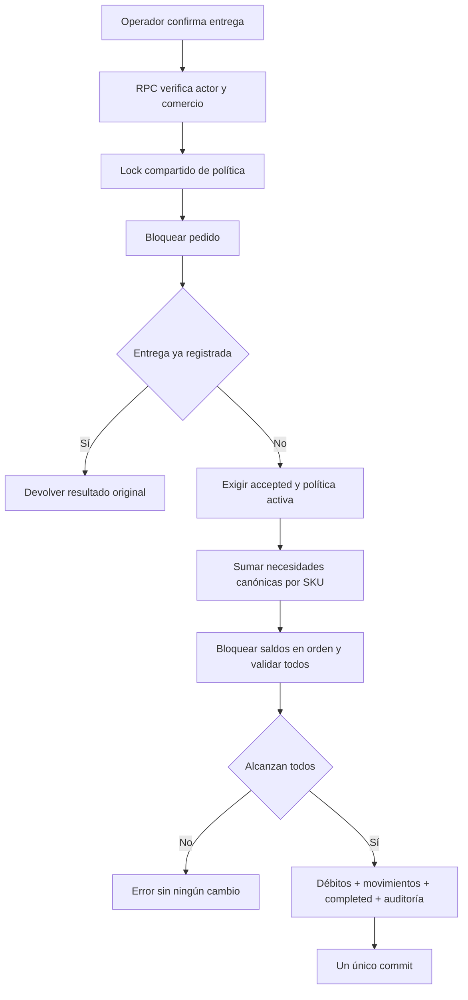

# Plan mayorista y stock al entregar

Fecha: **24/10/2026**. Plan acordado e implementación por etapas en `feature/mayorista-stock`. Código auditado originalmente: `bf183767b8ba6012e2d33d177e473d5534669b9c`; documentos anteriores preservados en `97c6a36`, `fc8c43d` y `68cf0eb`. El usuario levantó la restricción documental y autorizó crear y aplicar migraciones, incluso productivas, con respaldo y validación aislada. Estado, evidencia, cambios y pendientes en [IMPLEMENTACION_MAYORISTA_STOCK.md](IMPLEMENTACION_MAYORISTA_STOCK.md); los hallazgos históricos permanecen en [AUDITORIA_MAYORISTA.md](AUDITORIA_MAYORISTA.md).

Reglas confirmadas por el usuario (24/10/2026): **entregado significa recepción por el cliente o retiro realizado**, **aceptar reserva mercadería; entregar descuenta la existencia física y consume la reserva**, **venta por unidades enteras**, **la app es la fuente principal del stock**, **ventas externas cargadas manualmente** y **entregas y devoluciones completas**. Cajas, fracciones, conversiones, entregas parciales y devoluciones parciales quedan fuera del alcance inicial. `generated` y abrir WhatsApp no reservan ni descuentan. Se conserva `completed` por compatibilidad; no confirma cobro. Para activar quedan pendientes los responsables operativos, el alcance físico y conciliación del tránsito, el volumen del piloto y el corte/conteo inicial. Estas cuestiones no impiden las correcciones independientes.

El objetivo cabe en React/PostgreSQL/Supabase/Vercel actuales. La suficiencia de suscripciones y la posibilidad de uso comercial aún requieren G02; no se autorizan upgrades ni otros servicios. No se agregan ERP, contabilidad, logística, microservicios ni integraciones inventadas.

## Alcance de la primera versión

El lanzamiento se limita a **un mayorista piloto**, con su catálogo, operadores, canales y pico de pedidos acordados. La compatibilidad de los comercios actuales se conserva; no se desarrolla una solución universal para otros rubros. Los requisitos se separan en tres grupos:

1. **Correcciones y requisitos indispensables:** permisos S01, entradas acotadas S03/S04, importación segura C02/C10/C11, **SKU automático y simplicidad RF-SKU confirmado**, idempotencia de pedidos O03 y reproducibilidad G01. C05 aplica si usa opciones; C01 y O02 se cierran cuando el catálogo o los pedidos reales alcanzan sus límites. Se comprueban esas condiciones antes del piloto, sin presumirlas resueltas.
2. **Inventario mínimo:** entrega atómica, saldos y movimientos inmutables, permisos, ingresos/ajustes, corte físico, tratamiento de pendientes, ventas externas conforme a la fuente principal acordada, correcciones/devoluciones y reportes coherentes, pausa segura y validación real. Las decisiones comerciales de la sección siguiente fijan su alcance definitivo.
3. **Mejoras posteriores:** escalas muy superiores al piloto, optimización SQL/virtualización sin cuello medido, directorios globales, rediseños, precios avanzados e integraciones no requeridas. No bloquean el piloto por estar incluidas en la auditoría.

Los resultados sintéticos de 1.500/5.000 productos se conservan como evidencia exploratoria. No hay obligación de repetir toda la matriz A/B/C ni de optimizar para 50 comercios antes de operar uno. Sí es obligatorio medir el catálogo y pico acordados del mayorista, con margen documentado, y corregir cualquier problema que afecte ese alcance. Un mock del backend sólo evalúa frontend y contratos simulados, **no certifica capacidad ni integridad productiva**.

## RF-SKU — Código automático y facilidad de uso, confirmado para la primera versión

Este requisito se incorpora a **productos/importación (B03-SKU)** y a la aceptación del lanzamiento. No es una decisión comercial pendiente ni una mejora opcional. Se reutiliza **`products.code`**, que ya almacena texto; no agregar un campo `sku` equivalente. `products.id` (UUID) sigue siendo la identidad estable de pedidos, stock, imágenes y demás vínculos internos. Generar un código no inicializa stock ni modifica existencias.

### Contrato funcional y experiencia

- **Alta manual y Excel/CSV:** código omitido, vacío o compuesto sólo por espacios significa generar uno en servidor al guardar. La columna `codigo` deja de ser obligatoria. Nombre, categoría, precio y demás validaciones pertinentes conservan su contrato; no pedir al usuario inventar códigos.
- **Código informado:** conservarlo como texto, incluidos ceros iniciales, mayúsculas/minúsculas y separadores válidos; nunca convertirlo a número. Mantener el límite compatible de 80 caracteres, rechazar controles/saltos de línea y códigos duplicados con mensaje claro. Tratar sólo espacios exteriores como limpieza explícita del contrato; no alterar ceros ni caracteres interiores. Comparar unicidad con la misma regla de servidor/DB, actualmente sin distinguir mayúsculas, sin cambiar la representación guardada. No aplicar al código manual el formato del generador.
- **Excel/CSV:** leer la columna como texto. Preservar `000123` textual y verificar la lectura de celdas Excel con formato de ceros iniciales; si la biblioteca pierde ese formato, resolverlo en el adaptador o dar un error accionable antes de importar, nunca aceptar silenciosamente `123` por `000123`. No es posible recuperar ceros ya eliminados del archivo fuente. Los archivos de resultado deben permitir ida y vuelta sin perder códigos ni ejecutar fórmulas.
- **Edición:** nombre, precio, imágenes o stock nunca regeneran el código. Si una actualización identificada por UUID envía código vacío/omitido, conservar el existente. Si se permite un cambio explícito de código no vacío, validar permisos/unicidad y mantener UUID e historia. Un archivo sin código ni UUID válido identifica una **alta nueva**, no una actualización por nombre. En modo sólo actualización, esa fila se rechaza sin crear productos. Si llegan UUID y código incompatibles, rechazar; no elegir silenciosamente otro producto.
- **Interfaz:** etiqueta exacta **“Código / SKU (opcional)”** y ayuda **“Si lo dejás vacío, lo generamos automáticamente”**. Mostrar el código definitivo después de guardar; en edición, aclarar además “Si lo dejás vacío, conservamos el código actual” para no prometer regeneración. Sin configuración de prefijos, secuencias, rangos ni pasos obligatorios adicionales. La vista previa existente informa cuántas filas crearán productos nuevos y cuáles actualizarán/omitirán, usando texto como “Las filas sin código crearán productos nuevos” para filas sin identidad de actualización. Un nombre coincidente no cambia esa clasificación.
- **Resultado descargable:** al terminar, ofrecer “Descargar resultado” con fila de origen, código definitivo, UUID y resultado creado/actualizado/omitido, manteniendo los campos necesarios para futuras actualizaciones. XLSX con códigos tipados como texto, o CSV con lectura textual documentada y comprobada; no inventar fórmulas `="000123"` para preservar ceros. Escapar/sanitizar fórmulas en exportaciones sin cambiar el código almacenado y verificar su reimportación. Recuperar la descarga desde el resultado persistido tras recarga o respuesta perdida.

**Simplicidad transversal confirmada:** productos, importaciones, pedidos y stock deben usar pocos campos obligatorios, acciones claras, mensajes comprensibles y el mínimo de pasos. Identificadores de lote/fila, locks, hashes, reintentos y numeración son internos. Usar el flujo y diseño existentes; completar un alta o importación sin código no agrega pantallas ni confirmaciones respecto del mismo flujo con código. Solicitar sólo datos que hacen falta para la acción; mostrar opciones avanzadas cuando correspondan, sin ocultar faltantes, errores ni el efecto de una operación.

### Generación, identidad de lote y compatibilidad

1. **Generación única en servidor:** una única rutina DB compartida por alta manual/importación, dentro de la transacción de guardado, devuelve un código corto y legible. Propuesta técnica interna: `P-000001`, con contador atómico por comercio y crecimiento del ancho cuando sea necesario; sin ajuste por usuario ni promesa de numeración consecutiva. Nunca `MAX(code)+1` ni una comprobación previa en frontend. Validar y reservar primero todos los códigos informados del lote antes de generar para filas vacías; el resultado no depende de su orden. Resolver colisiones con códigos informados sin modificarlos; constraint de unicidad y locks/reintentos acotados en servidor aseguran simultaneidad. Una colisión automática nunca se convierte en upsert sobre otro producto. Todas las rutas autorizadas de asignación respetan la misma protección y el orden de locks compatible con la política de stock.
2. **Unicidad e historia:** no asignar a otro producto un código ya usado en el comercio, incluido uno archivado, para evitar que una planilla vieja actualice un producto distinto. La base actual sólo impide duplicados entre no eliminados: revisar duplicados/reutilizaciones históricos y planear protección incremental de nuevas asignaciones, sin renumerar existentes automáticamente ni cambiar vínculos UUID. Un código informado en conflicto produce error de fila; un candidato automático en conflicto busca otro. La reactivación conserva la identidad y se valida contra conflictos históricos.
3. **Operación y fila estables:** el sistema crea un ID de lote y referencias internas de fila antes del primer envío, persistidos para recuperación; el usuario no los configura. El servidor vincula comercio + ID de lote + hash del contenido/modo y guarda resultado por fila (UUID, código asignado, acción). Lote, productos y resultado se confirman atómicamente; misma clave/contenido devuelve el mismo resultado, clave con contenido diferente da conflicto. Replay no vuelve a escribir precios ni otros cambios posteriores. En alta manual, un ID estable de intento/UUID evita duplicar el producto y código ante doble clic o timeout.
4. **Reintento versus importación nueva:** retry, recarga, desconexión y reenvío concurrente conservan la misma operación. Al volver a seleccionar el mismo archivo, recuperar/detectar el intento previo dentro del comercio y ofrecer su resultado o continuación como camino normal; no convertir una respuesta incierta en lote nuevo. Iniciar deliberadamente una nueva importación usa otra operación y avisa en la vista previa que filas sin código/UUID crearán nuevos productos, aunque tengan nombres iguales. El hash sirve para detectar/reconciliar intentos, no para impedir para siempre una importación nueva de contenido idéntico. Mantener registro de deduplicación/resultado; un vencimiento de recuperación nunca autoriza recrear silenciosamente un lote ya confirmado.
5. **Relaciones y fotos:** mapa interno fila → UUID → código definitivo en el resultado. Asociar ZIP/imágenes por fila y UUID, no por un código de entrada que puede estar vacío. Preservar relaciones de grupos/opciones existentes; cuando un archivo use hojas relacionadas sin código, admitir una referencia inequívoca a la fila de Productos, sin SKU inventado ni asociación por nombre. No añadir referencias obligatorias al catálogo simple; las relaciones ambiguas se rechazan antes de escribir. Imágenes siguen fuera de la transacción DB: un fallo/reintento sólo repite pendientes y no recrea metadata ni cambia códigos.
6. **Entrega incremental:** ajustar editor, parser/plantilla, contratos TS/Zod/Edge, RPC de alta/importación, resultado/descarga y pruebas en una etapa de catálogo propia, separada de stock y S01. Migración nueva para generador, deduplicación y permisos; no editar migraciones aplicadas. Conservar contratos con código informado de clientes actuales, revisar escrituras directas para que no eludan guardias, y desplegar servidor compatible antes del frontend. Ante contingencia, pausar altas/importaciones afectadas conservando productos, códigos y resultados; no regresar a una ruta que duplique lotes.

### Aceptación obligatoria RF-SKU de la primera versión — pruebas futuras

| ID | Escenario | Resultado obligatorio |
|---|---|---|
| SKU01 | Alta manual con código omitido, vacío y espacios | Guarda con `code` automático no vacío, corto y legible; devuelve UUID/código, sin pedir código ni agregar pasos |
| SKU02 | CSV/XLSX sin columna `codigo`, con columna vacía y mezcla de filas con/sin código | Genera sólo para las altas sin código; códigos informados conservados; varios vacíos no se tratan como un duplicado |
| SKU03 | `000123`, `Ab-001`, códigos de 80/81 caracteres, controles/saltos de línea y celdas Excel con formato `000000` | Preserva representación válida y ceros, acepta hasta 80, rechaza longitud/caracteres inválidos con fila/campo y sin escritura parcial; no conversión numérica silenciosa |
| SKU04 | Editar nombre/precio/stock; enviar código vacío/omitido al actualizar producto identificado | UUID y código existente no cambian; no se borra ni regenera el código ni se reescriben snapshots de pedidos/stock |
| SKU05 | Duplicado informado en lote/tenant, incluidas variantes de mayúsculas y código archivado; mismo código en otro tenant | Conflicto claro dentro del comercio conforme a unicidad; otro comercio independiente sin fuga. No renumerar código informado para “resolver” el error |
| SKU06 | Dos conexiones reales crean manual/importación simultáneamente; candidato automático coincide con código informado, incluso en una fila posterior | Ningún duplicado, cada producto conserva su asignación; colisión automática resuelta internamente sin upsert accidental y código informado intacto independientemente del orden de filas. Mismo UUID de alta manual concurrente conserva un solo código |
| SKU07 | Doble envío concurrente del mismo lote y timeout posterior al commit; recarga/reselección del archivo | Mismos UUID/códigos y resultado descargable, sin productos ni operaciones duplicados y sin sobrescribir ediciones posteriores; no generar nueva clave ante estado incierto |
| SKU08 | Misma clave de lote con contenido/modo cambiado; fallo antes de commit | Conflicto sin cambios para clave reutilizada; fallo revierte metadata y resultado juntos. Retry válido crea una sola vez; no prometer secuencia sin huecos |
| SKU09 | Nueva importación deliberada sin códigos con nombres coincidentes | Vista previa informa altas nuevas; no actualiza/fusiona por nombre. Reimportación del resultado con códigos sí encuentra los productos del comercio según el modo elegido |
| SKU10 | Modo sólo actualización sin código ni UUID; UUID válido con código vacío; UUID/código contradictorios | Primer caso rechaza, segundo preserva código y actualiza campos permitidos, tercero rechaza; no alta ni cambio de identidad inesperados |
| SKU11 | Descargar/reimportar resultado, incluidos ceros iniciales, código con riesgo de fórmula, filas repetidas y omitidas | Códigos tipados/conservados, CSV/XLSX seguro sin ejecución de fórmulas, trazabilidad de filas y futuros updates correctos; no fórmulas como mecanismo de codificación |
| SKU12 | Productos sin código con fotos y hojas relacionadas; una imagen falla y se reintenta | Fotos/grupos/opciones quedan en el UUID correcto, no se pierden asociaciones; metadata/códigos sin repetición; referencias ambiguas rechazadas |
| SKU13 | Anon, usuario de otro comercio o suspendido intenta generar, importar, consultar replay o descargar | Permisos reales/RLS rechazan sin exponer productos/resultados; contador/deduplicación sólo por operación autorizada |
| SKU14 | Operador carga producto y catálogo sin códigos, luego usa pedidos/stock | Label/ayuda exactos; mismos pasos básicos que con código, sin campos técnicos ni configuración de numeración. Mensajes explican efecto/error y acción de recuperación |

SKU01–SKU14 forman parte de la aceptación de B03-SKU y del piloto. Casos de unicidad, concurrencia, idempotencia, fallos y permisos se ejecutan contra PostgreSQL/Edge reales aislados, además de parser/UI; los mocks no certifican estas garantías. Los fixtures son sintéticos, con el volumen del mayorista. La ejecución SQL real, concurrencia, parser, XLSX e interfaz se registra por etapa en IMPLEMENTACION_MAYORISTA_STOCK.md; la integración HTTP completa y el piloto tienen gates separados.

## Decisiones comerciales — confirmaciones y pendientes

| ID | Decisión que debe registrar el mayorista | Impacto en alcance y aceptación |
|---|---|---|
| D01 | **Confirmado: recepción del cliente o retiro realizado.** Pendientes responsables y tratamiento físico del tránsito | Define débito y `completed_at`. Si el conteo excluye tránsito pero el débito espera recepción, hace falta conciliación/modelo explícito; no mezclar ambas bases |
| D02 | **Confirmado: reservar al aceptar y descontar al entregar** | La aceptación rechaza faltantes; cancelar libera reserva sin incrementar existencia. La implementación conserva reservas aceptadas hasta entrega/cancelación, sin vencimiento automático; confirmar si necesita otra política |
| D03 | **Confirmado por el usuario, 24/10/2026: empezar vendiendo por unidades enteras** | Pedidos, reservas, existencias y movimientos usan unidades enteras del producto. Sin cajas, fracciones ni conversiones en la primera versión; una promoción por cantidad no cambia la unidad física. Los límites de cantidad del piloto siguen sujetos a D08 |
| D04 | **Confirmado: cargar manualmente las ventas fuera de la app** | Registrar todos los productos de una venta en una operación, con canal/referencia común, actor y motivo; respetar reservas y deduplicar reintentos. El procedimiento requiere registrarla al entregar, antes de cerrar la venta; asignar responsable antes de activar. Cargar sólo al final del día no mantiene disponible exacto |
| D05 | **Confirmado: la app es la fuente principal del stock** | Todas las salidas del alcance deben quedar registradas aquí. No se implementa sincronización ni se mantienen dos saldos oficiales; una futura integración requiere contrato propio |
| D06 | **Confirmado: devoluciones completas en la primera versión** | Requiere recepción real de toda la entrega, operación original y reposición vendible explícita; mercadería dañada no repone saldo vendible. Reponer sólo parte de una devolución completa no equivale a admitir devoluciones comerciales parciales. Sin reintegro monetario automático |
| D07 | **Confirmado: entregas completas en la primera versión** | Una entrega completa por pedido, sin remanentes ni expediciones parciales. Correcciones administrativas y pedidos reemplazantes conservan el tratamiento trazable definido; no se agrega edición/sustitución parcial |
| D08 | Catálogo, pedido máximo, operadores simultáneos y dispositivos/redes reales | Fija pruebas de límites y carga del piloto, con margen acordado; 25 líneas/100 unidades actuales no se dan por suficientes |
| D09 | Responsables, ventana/corte físico, pendientes al inicio y frecuencia de conciliación | Permite activar saldos sin perder ni duplicar movimientos entre contar y registrar |

Registrar respuesta, responsable y fecha. D01–D07 ya fijan el contrato funcional descrito, con los detalles operativos pendientes indicados expresamente. **La activación exige resolver esos detalles y D08/D09, además de los gates técnicos.** La estimación al final dimensiona ese alcance; no es fecha de entrega ni validación de capacidad productiva.

## Diseño mínimo de stock y contrato de activación

### Modelo y límites deliberados

La arquitectura actual es suficiente para resolver consistencia dentro de PostgreSQL/Supabase; no requiere colas, Redis, VPS ni otro servicio. No implica que capacidad/plan contratado estén verificados.

- `restaurants.inventory_mode`: `never_enabled` para comercios que nunca activaron stock; primera activación a `enforced`; luego sólo `enforced` ↔ `paused`. `inventory_started_at` inmutable tras activación y versión de política. **No existe desactivación que vuelva a crear pedidos sin control.** Estado validado en servidor; constraint/RPC impiden volver a `never_enabled` y falsificar snapshots. El frontend sólo lo presenta.
- `restaurants.inventory_cutover_in_progress`: bandera persistida del corte, inicialmente falsa, en la misma fila de política. Se activa/audita con lock exclusivo antes del conteo; **prevalece sobre `never_enabled`** y bloquea operaciones afectadas en todas las rutas vigentes, incluidas RPC usadas por UI antigua. No es un cuarto modo ni se controla desde el cliente. Sólo finalización del lote de apertura/ajuste conciliado y, cuando corresponda, activación la libera atómicamente; abortar un corte exige revisión y registro explícitos, nunca liberación automática por timeout.
- La versión implementada administra todos los productos del mayorista activado, sin agregar un campo equivalente por producto. Se incluyen en conteos los archivados que mantienen saldo o pedidos pendientes. `available` sigue siendo bloqueo comercial manual y se combina con stock cuando se proyecta disponibilidad; no reemplaza cantidad.
- `inventory_balances(restaurant_id, product_id, on_hand bigint, reserved bigint, version bigint, initialized_at, updated_at)`, PK `(restaurant_id,product_id)`, FK compuesta a products; constraints `on_hand >= reserved >= 0`. Disponible es `on_hand - reserved`. **Fila ausente significa no inicializado**, no stock cero inventado. Una fila con cero sólo nace de conteo inicial explícito. Nunca editar saldo desde frontend.
- `inventory_operations` conserva identidad idempotente, hash, tenant, actor, motivo, pedido y operación original cuando corresponda. Unicidad de entrega por pedido y de reversión completa, con FKs compuestas. La implementación distingue count, reserve, release, receipt, delivery, adjustment, return, correction y external_sale. Motivo obligatorio para ajuste/corrección y canal/ref para venta fuera de app. Sin tablas de proveedores/logística.
- `inventory_movements` conserva deltas separados de existencia y reserva, saldos resultantes y cantidad físicamente devuelta. Una reserva cambia sólo reservado; una devolución no vendible puede registrar recepción sin incrementar existencia. FK compuestas y unicidad por operación/SKU; ledger inmutable reconciliable. Los conteos guardan explícitamente cero aunque no produzca cambio de saldo.
- `orders.inventory_policy_snapshot`/versión e `order_items.inventory_tracked_snapshot`, `stock_product_id_snapshot`, `sales_unit_snapshot`, `base_units_per_sale_snapshot`, `stock_quantity_base_snapshot`. Se calculan en servidor al crear, nunca desde precio, código libre ni datos reenviados por el cliente. Para el mayorista activado ningún pedido nuevo recibe política legacy, incluso durante contingencia. Una línea futura con producto no rastreable o conversión faltante impide entrega y solicita corrección explícita. Reconciliar las líneas repetidas por stock_product_id, independientemente de notas/opciones que afectan precio.
- Índices: movimientos `(restaurant_id,product_id,created_at DESC,id)` y `(restaurant_id,order_id)` vía operación; operaciones por idempotencia/entrega. Sin índices indiscriminados ni almacenamiento duplicado de PII.

**Unidades confirmadas:** venta y stock en unidades enteras del producto; `code` identifica el producto y las opciones no son inventario independiente. El mínimo implementado usa un producto = un SKU físico. Una promoción 6× modifica precio/cantidad, no representa una caja ni una conversión física. Las cajas y fracciones quedan como ampliaciones posteriores, con conversión exacta y snapshot si se acuerdan; no forman parte de este piloto.

### Operación única de entrega y concurrencia

Se puede mantener `complete_order(uuid)` como interfaz compatible, pero debe delegar a la única lógica `deliver_order`/helper privado. **No dejar un RPC antiguo ni un UPDATE directo que permita saltar stock.** API pública recibe order_id y opcional UUID de operación; cantidades/precios/actor/tenant se derivan en servidor. La idempotencia semántica por pedido protege aun con claves distintas.

Pseudoflujo dentro de **una sola transacción DB**:

1. Exigir auth.uid, perfil activo y rol permitido. Consultar tenant del pedido y comprobar pertenencia antes de devolver estado o resultado de replay. `SECURITY DEFINER SET search_path=''`, nombres calificados y EXECUTE sólo authenticated; helper privado no invocable anónimamente. La autoridad de política es la fila de `restaurants`: tomar `FOR SHARE`, compatible entre operaciones ordinarias; activación/pausa toman `FOR UPDATE` en esa misma fila. Mantenerlo hasta commit para serializar el corte sin serializar todas las entregas entre sí.
2. `SELECT orders ... FOR UPDATE` por ID, tenant autorizado. Esta fila serializa entregar, cancelar y cualquier futura edición/corrección. Todas las rutas respetan **política → pedidos en orden → operación original si aplica → saldos en orden**; nunca tomar saldo antes del pedido ni política después. Revalidar autorización con el contrato de membresías antes de mutar.
3. Si ya existe operación de entrega: devolver resultado persistido y flag `alreadyDelivered`, incluyendo si fue luego corregida/devuelta; **nunca volver a descontar**. Si es un completed histórico terminal previo al corte, sin ledger y con snapshot legacy explícito: devolver legado completado sin crear movimiento retroactivo. Si política tracked y completed sin ledger: error de integridad, no inventar éxito ni descontar a ciegas.
4. Si no es replay, exigir estado anterior `accepted`. Con política `paused` o `inventory_cutover_in_progress=true`, devolver `INVENTORY_PAUSED` o `INVENTORY_CUTOVER` antes de mutar. El camino histórico sin stock sólo existe en un comercio `never_enabled`, sin corte en curso, sin fecha de activación y con pedido legacy; un snapshot legacy abierto en un comercio ya activado es error de integridad, no permiso para entregar. Con política `enforced`, exigir snapshot controlado completo y efectuar el débito. Leer líneas persistidas y multiplicar conversiones snapshot con comprobación de rango; sumar por producto/SKU físico. No confiar en carrito ni ids/cantidades enviados de nuevo.
5. Bloquear **todas las filas de saldo** requeridas con `FOR UPDATE` en orden determinista de `(restaurant_id,product_id)`. Confirmar que no falta ninguna, que la reserva persistida del pedido coincide con sus líneas y que existencia/reserva alcanzan la suma. No usar lectura previa en JS ni secuencia de peticiones por producto. No usar SKIP LOCKED para descontar pedidos: se espera o se devuelve error reintentable, no se saltean ítems.
6. Insertar operación de entrega protegida por UNIQUE; reducir existencia y reserva juntas, comprobar filas e insertar movimientos con ambos deltas y saldos resultantes. La aceptación previa reserva únicamente disponible; cancelar libera sólo reserva. Validación de todos antes de mutar facilita errores legibles; `on_hand >= reserved >= 0` es defensa adicional.
7. Cambiar accepted→completed, completed_by/auth.uid y completed_at, registrar order_events y audit_logs vinculados a operation_id. Retornar resumen estable. Toda excepción aborta saldo, movimientos, evento y estado juntos. No capturar excepciones para continuar con un subconjunto.

**Dos operadores, mismo pedido:** el segundo espera lock del pedido y obtiene replay tras el primer commit; una sola entrega/evento. **Timeout post-commit:** repetir devuelve la misma operación aunque la respuesta anterior se perdiera. **Dos pedidos, mismas últimas unidades:** locks de saldo comunes serializan; el segundo vuelve a ver saldo actualizado y falla completo por insuficiencia. **Varios SKU:** orden determinista reduce deadlocks; si ocurre deadlock/transitorio, retry acotado de la transacción completa con misma idempotency key; nunca de sentencias individuales. Todas las reposiciones/ajustes/devoluciones usan el mismo orden de locks para evitar actualizaciones perdidas.

El servidor devuelve códigos de negocio: NOT_ACCEPTED, INVENTORY_PAUSED, INVENTORY_CUTOVER, INVENTORY_NOT_INITIALIZED, INSUFFICIENT_STOCK (lista mínima autorizada), ALREADY_DELIVERED, IDEMPOTENCY_CONFLICT. UI bloquea botón mientras está pendiente y refresca respuesta, pero eso es comodidad: la garantía reside en la transacción y constraints.

### Pausa operativa sin desactivar protecciones

| Estado del comercio | Nuevos pedidos, aceptación y salidas | Lectura, corrección y recuperación |
|---|---|---|
| `never_enabled` | Conserva comportamiento actual sin inventario si no hay corte en curso; `inventory_cutover_in_progress` bloquea creación/aceptación/entrega/salidas afectadas también por RPC antigua | No inventa saldos ni movimientos históricos; replay histórico sólo lectura |
| `enforced` | Nuevos pedidos con snapshot obligatorio; entrega y salida externa siempre transaccionales con stock | Operaciones autorizadas y auditadas |
| `paused` | Se bloquean crear pedidos afectados, aceptar, entregar y registrar nuevas salidas externas por UI, Edge, RPC vigente o antiguo. No se generan nuevos snapshots legacy | Lecturas y replay de operaciones ya confirmadas siguen disponibles; cancelación sin salida puede permitirse. Conteos/conciliaciones/correcciones sólo por RPC de mantenimiento autorizado, sin habilitar ventas |

Al confirmar la pausa, todas las operaciones anteriores que tenían lock compartido ya terminaron; las posteriores observan `paused` y fallan sin efectos. La pausa no se declara efectiva antes de obtener el lock exclusivo. Probar carreras de pausa contra creación/aceptación/entrega, incluidas sesiones con frontend anterior. La operación física de los canales afectados también debe detenerse: si no puede garantizarse, el comercio permanece pausado hasta registrar y conciliar esas salidas. Una devolución recibida durante contingencia se separa físicamente y se documenta para conciliación; no se vuelve vendible por un flag.

Conservar saldos, movimientos, claves de idempotencia, snapshots y guardias del RPC de pedidos existentes. Un rollback de UI no restaura funciones capaces de eludir stock. La reanudación exige conciliación verificada y queda auditada. Esta pausa es una contingencia del mayorista; no cambia el flujo de otros comercios `never_enabled`.

### Estados, cancelaciones, correcciones y devoluciones

| Transición/acción | Efecto en existencia | Regla |
|---|---|---|
| Crear/generated | Ninguno | Reserva atómica al aceptar; si falta disponible, no aceptar. D02 confirmado |
| Intento WhatsApp/whatsapp_opened | Ninguno | No demuestra envío ni aceptación |
| Tomar/accepted | Ningún débito físico; incrementa reservado | D02 confirmado: reservar y aceptar atómicamente, rechazando faltantes |
| accepted→completed (entregado) | Débito atómico una vez | Entrega física confirmada; actor y movimientos |
| generated/whatsapp_opened/accepted→cancelled | Ninguno | Nunca reponer lo no descontado; liberar la reserva existente sin incrementar existencia física |
| generated/whatsapp_opened→expired | Ninguno | No restaurar existencia |
| Editar pendiente | Cancelar libera la reserva; recrear no reserva hasta aceptar | Hoy no existe edición; mínimo cancelar/recrear. Si se implementa, RPC lock de pedido, recalcular precios/conversiones, versión y evento; no alterar snapshots silenciosamente |
| Modificar/reabrir entregado | Prohibido por flujo ordinario | No borrar entrega ni habilitar segundo débito |
| Entrega registrada por error | Compensación trazable autorizada | Sólo si no hubo salida física, motivo y referencia a entrega; conserva original y evento de corrección |
| Devolución física | Entrada explícita después de recepción | No automática por cancelación administrativa; actor, motivo y operación original |

**Corrección administrativa:** una entrega marcada por error, sin salida física, genera compensación completa autorizada con motivo/actor y referencia única a la entrega. El original queda `completed` histórico con resultado operativo **corregida**; no se reabre ni vuelve a descontar. Si sólo se corrige texto o precio y hubo salida real, no se repone mercadería: el ajuste monetario es otro contrato y no se infiere de este flujo.

**Devolución física completa, confirmada:** requiere recepción real de toda la entrega; el resultado operativo queda **devuelta**. No equivale a cancelación ni confirma reintegro de dinero. La mercancía dañada/no vendible no vuelve automáticamente a `on_hand` vendible: registrar recepción y destino/no reposición; el saldo sigue la cantidad efectivamente reincorporada. Se admite una compensación completa por entrega y se excluye una segunda corrección/devolución completa. Las devoluciones comerciales parciales quedan fuera de esta versión; su ampliación independiente se estima al final. Reponer parte de la mercadería recibida por su condición vendible conserva el carácter completo de la devolución.

**Reemplazo:** nuevo pedido con `replaces_order_id`, `root_order_id` y motivo; referencias dentro del mismo tenant, sin ciclos ni sucesores concurrentes para la misma corrección. Conservar la cadena completa. Una entrega inválida corregida no cuenta junto a la válida de su reemplazante como dos entregas comerciales. Un reemplazo posterior a una devolución física sí puede representar otra expedición real: registrar ambas salidas físicas y la devolución, aunque pertenezcan al mismo caso comercial. No deduplicar movimientos reales por compartir raíz.

**Interfaz y reportes mínimos obligatorios:** lista, detalle, tablero y CSV distinguen “entrega vigente”, “entrega corregida”, “devuelta” y, si corresponde, “devuelta parcialmente”; muestran operación original, motivo, fecha, actor y enlace al reemplazante. `status=completed` solo no alcanza como filtro. El pedido reemplazante tiene su propio estado y no convierte la entrega original en vigente.

| Medida | Regla verificable |
|---|---|
| Casos comerciales entregados vigentes | Contar por raíz los casos con entrega válida vigente según el contrato acordado; excluir originales corregidos y devoluciones totales; mostrar parciales por separado si se habilitan |
| Unidades entregadas netas | Salidas válidas menos cantidades físicamente devueltas, con detalle de correcciones; no sumar el original corregido y su reemplazo. No confundir cantidad devuelta con cantidad reincorporada vendible |
| Expediciones físicas brutas | Mostrar salidas reales y retornos por separado; una entrega corregida sin salida física se excluye. Una expedición real de reemplazo no se oculta |
| Saldo de inventario | Apertura + ingresos + ajustes + reposiciones por corrección/retorno vendible − entregas/salidas externas; siempre igual a suma de movimientos |
| Fechas e importes | Entrega por `completed_at` acordado, corrección/devolución por su fecha propia. La vista de vigencia puede cambiar retrospectivamente; el libro de movimientos por fecha conserva el evento y ajuste de cada día. Importe asociado a una entrega errónea de $100 seguida de reemplazo de $100: vigente $100, no $200; mientras el reemplazo no se entrega, vigente $0. Valorar devoluciones requiere regla explícita para descuentos/envío/redondeos; no inferir reintegro ni ingresos cobrados. Exportar vínculos y eventos para explicar netos |

Ejemplo mínimo: entrega A de 10 marcada por error → corrección +10 → reemplazo B entrega 10: una entrega comercial vigente, 10 unidades netas, historial A visible como corregida y saldo neto −10. Si A sí salió y volvió completa antes de B: dos expediciones físicas brutas, una devolución de 10 y 10 unidades netas; no dos casos comerciales vigentes. Probar ambos y correcciones de un período anterior, mostrando ajustes en su fecha sin alterar silenciosamente el historial.

### Existencia, disponibilidad y reservas

| Política | Ventaja | Consecuencia/Complejidad |
|---|---|---|
| Validar y descontar al entregar | Menor cambio, coincide con regla confirmada; saldos siempre físicos | Varios pendientes pueden competir por últimas unidades. El primero que entrega gana; aceptación no garantiza disponibilidad; requiere faltantes/cancelación/sustitución acordada |
| Reservar al tomar, consumir al entregar | Permite prometer disponible al aceptar sin adelantar descuento físico | `available = on_hand - reserved`, ledger/estados de reserva, liberación al cancelar/editar, expiración de reservas/retenciones y locks adicionales; las ventas externas deben respetarla |

**Decisión confirmada:** se implementan reservas al aceptar. La aceptación y la reserva se confirman juntas bajo locks; si falta disponible, no se acepta. Al entregar se reducen existencia y reserva; cancelar libera sólo la reserva. Los pedidos generados compiten hasta su aceptación. Consultar stock antes de aceptar sigue siendo informativo; la RPC decide atómicamente.

### Permisos y acceso

- Lectura saldos/movimientos: `restaurant_admin` y `order_manager` activos del mismo comercio; considerar ocultar ajustes internos al gestor si negocio lo pide, sin inventar nuevos roles por defecto.
- Entregar: roles que actualmente `private.can_manage_orders` autoriza, manteniendo superadmin con AAL2. Pertenencia y perfil se revisan en servidor incluso en replay.
- Carga inicial, ingresos, ajustes, ventas fuera de app, correcciones y devolución: `restaurant_admin` del comercio; superadmin AAL2 sólo soporte explícito auditado. `order_manager` no ajusta inventario arbitrariamente.
- RLS de lectura tenant; sin INSERT/UPDATE/DELETE de saldo/ledger para anon/authenticated, sólo RPCs estrechos. Revocar PUBLIC por defecto y verificar grants explícitos en migraciones nuevas. Movimientos/operaciones append-only, UPDATE/DELETE protegidos. Un GUC interno no reemplaza permisos/RLS.
- Menú público sólo devuelve disponibilidad necesaria (o cantidad pública si negocio lo autoriza); nunca actor/motivos/costos/ledger. Para productos sin control conservar `available`. Para controlados usar `available AND stock>0`, sin prometer disponibilidad futura.

### Ventas por otros canales

**D04/D05 confirmadas:** la app es la fuente principal y las ventas fuera de ella se cargan manualmente. Cada venta externa incluye uno o varios productos/cantidades y una referencia común de canal/comprobante, con actor registrado y nota opcional. La referencia se muestra también en el historial para reconocer el comprobante y revisar duplicados. Todos sus SKU se confirman en una operación atómica, con la misma idempotencia, pausa y locks; un faltante o versión desactualizada no descuenta parcialmente. Se registra al hito de entrega acordado, antes de cerrar la venta, y se asigna un responsable antes de activar. Un pedido de la app no se vuelve a registrar como venta externa: referencia de origen única y revisión de duplicados. No se permite consumir mercadería reservada para otros pedidos.

Fuera del alcance inicial: si en el futuro se cambia la fuente principal por otro sistema, documentar dirección del intercambio, identificadores, frecuencia, resolución de conflictos, reconciliación y qué operaciones bloquea una desconexión. **Esa integración no está incluida en el mínimo ni estimada sin contrato.** No se implementa una sincronización implícita por haber acordado carga manual de ventas externas.

Importación de productos **no escribe stock**; conteo/reposición se carga por operación separada con preview, motivo, idempotency key y totales. El inventario sólo representa las existencias del alcance físico acordado; D01 debe hacer compatible ese alcance con mercadería en tránsito.

### Corte del conteo físico y ajustes posteriores

**Alternativa mínima: ventana sin movimientos.** Cerrar operativamente todos los canales del alcance y bloquear en servidor creación/aceptación/entrega/salidas afectadas durante el corte (`inventory_cutover_in_progress` para primera carga; `paused` y corte para recuentos). No mantener una transacción SQL abierta durante el conteo físico. Registrar sesión de conteo, SKU, unidad, cantidad, persona, `counted_at`, `recorded_at` y frontera de movimientos. Verificar que tampoco hubo ingresos, devoluciones ni movimientos físicos no cargados. Las RPC de mantenimiento rechazan movimientos ordinarios durante esa ventana; sólo el lote de corte puede finalizar o una conciliación explícita puede sustituirla. Aplicar apertura/ajuste y, cuando corresponda, activación en una transacción corta con locks y versión esperada; liberar la ventana sólo tras confirmación y conciliación. Finalizar un recuento no levanta por sí solo una pausa por otra contingencia.

**Alternativa si no se puede detener todo: conciliación explícita.** Registrar por SKU el instante/frontera de su conteo, y todos los movimientos físicos posteriores hasta el registro. No usar una fecha global para productos contados a distintas horas. Calcular `cantidad objetivo al registrar = cantidad contada + entradas posteriores − salidas posteriores` en la misma unidad y ámbito físico. Conservar evidencia, referencias de origen y quién concilia; una marca horaria sola no prueba que estén todas las operaciones ni su orden. Para saldos ya activos, usar también una frontera/version del ledger y reconciliar salidas físicas todavía no registradas.

En ajustes posteriores, después de bloquear el saldo y revalidar la frontera: `delta de ajuste = cantidad objetivo conciliada − saldo actual`. Los movimientos ya reflejados en saldo se usan para trasladar el conteo al momento actual, **no se insertan otra vez**. Ejemplo: saldo 10, conteo 10 a las 10:00, entrega registrada de 2 a las 10:05; a las 10:10 el objetivo es 8 y el saldo es 8: ajuste 0, nunca reponer 2. Para apertura sin ledger previo, elegir y documentar una sola representación: saldo inicial conciliado al corte, con movimientos previos sustentados en el acta de conciliación y sin volver a debitarlos, o apertura al conteo y movimientos posteriores identificados una vez. El mínimo usa la primera; no mezclar ambas.

Preview muestra conteo, frontera, movimientos conciliados y saldo resultante por SKU. Si cambia la versión después del preview, recalcular y pedir nueva revisión; no sobrescribir. `expected_version` detecta escrituras registradas, **no mercadería movida sin cargar**. Si falta evidencia, detener/recontar; “conté ayer y subo hoy” sin conciliación se rechaza. La carga inicial cero es explícita; ausencia de conteo sigue siendo no inicializado. Guardar el acta y los identificadores necesarios sin incluir PII ajena al inventario.

### Incorporación compatible, corte y reversión

1. Migración aditiva futura: `never_enabled` para comercios sin inventario, sin llenar existencias ni tocar históricos. Probar instalación limpia **y actualización de la base vigente con datos sintéticos**; compatibilidad de UI/Edge anteriores y nuevos. Aplicar sólo después de respaldo y validación aislada; ejecución productiva autorizada por el usuario.
2. Resolver D01–D09 y ejecutar la ventana o conciliación de conteo descrita arriba. Preview por UUID/código resuelto dentro del comercio, duplicados/unidades validados. Cada saldo inicial tiene su corte y evidencia.
3. Antes de activar deben quedar **cero pedidos abiertos entregables con política legacy**: cerrarlos correctamente o incorporarlos en lote explícito auditado con mapeos/cantidades/snapshot, sin adelantar débito. Pedidos completed/cancelled/expired históricos no generan movimientos retroactivos. La mercadería pendiente aún dentro del ámbito contado forma parte del conteo, según D01.
4. Activar bajo lock exclusivo de política tras comprobar saldos, cobertura SKU y pendientes; registrar fecha/política. Creaciones e importaciones en curso deben quedar ordenadas respecto del corte. Toda alta nueva de SKU físico hereda control obligatorio/no inicializado; importación no crea excepciones silenciosas.
5. Piloto del mayorista, con gates reales aprobados y autorización expresa para producción. Revisar saldo físico y ledger cada jornada inicial; luego frecuencia acordada. Alertar sobre inconsistencias mediante capacidades existentes.
6. Contingencia: pasar a `paused`, conservar saldos/ledger/idempotencia/políticas y protecciones de pedidos existentes. Bloquear nuevas operaciones afectadas, incluidos pedidos y salidas externas; no ofrecer un modo de “seguir entregando sin stock”. No restaurar DB antigua ni funciones antiguas para borrar/eludir efectos. Compensar errores concretos con trazabilidad y reanudar sólo tras conciliación.

### Archivos y flujos concretos a modificar en la etapa futura

| Cambio | Lugares |
|---|---|
| Modelo/RLS/constraints/funciones inventario y hardened complete_order | Nuevas migraciones aditivas `supabase/migrations`, tests `supabase/tests`; regenerar `src/types/database.generated.ts` |
| Snapshot política/conversión al crear; hash idempotencia | Última `create_order_transaction` mediante nueva migración; `create-order/index.ts`, `_shared/schemas.ts`, `_shared/errors.ts` |
| Recuperación de checkout y cambio de total | `CheckoutPage.tsx`, `OrderGeneratedPage.tsx`, `checkout-attempt.ts`, schemas/domain; endpoint estrecho de recuperación si se incorpora |
| Cantidades/limites/líneas inválidas | `CartProvider.tsx`, `CartPage.tsx`, `ProductDialog.tsx`, `quantity-pricing.ts`, Edge schema y SQL |
| Entregar/mostrar faltantes/movimientos y actor | `OrderDetailPage.tsx`, `ClaimOrderPage.tsx`, `orderSchemas.ts`, `OrderStatus.tsx`, `src/lib/orders.ts`; nuevo panel inventario |
| Activación/carga inicial/reposiciones/ajustes | `RestaurantSettingsPage.tsx`, `ProductEditorPage.tsx`, `ProductsPage.tsx`, rutas `App.tsx`/`AdminLayout.tsx`; importación de stock separada de catálogo |
| Disponibilidad pública | `get_public_menu` wrapper vigente y helper, `PublicProduct`, API/Zod/usePublicMenu; caché invalidada al cambiar stock sin publicar ledger |
| Fechas de entrega, estados vigente/corregida/devuelta, vínculos de reemplazo y reportes netos | `get_order_metrics` nueva versión, `AdminDashboardPage.tsx`, `OrdersPage.tsx`, `OrderStatus.tsx`, detalle y CSV; agrupar antes de unir ítems/movimientos para no multiplicar importes |

### Criterios de aceptación futuros (no ejecutados)

| ID | Caso | Resultado obligatorio |
|---|---|---|
| AC01 | Entrega normal de 2 SKU con saldo | Estado+actor+evento+todos los movimientos/saldos se confirman juntos; snapshot monetario intacto |
| AC02 | Doble clic y reintento con igual o distinta key, mismo pedido | Una operación de entrega, un débito por SKU, una transición; retorno ya entregado |
| AC03 | Timeout después del commit / desconexión | Retry devuelve la misma operación/estado/saldo, sin nuevos movimientos |
| AC04 | Dos sesiones reales entregan mismo pedido simultáneamente | Un ganador; otro replay; actor original intacto |
| AC05 | Dos pedidos de 4 unidades compiten por 5 | Uno completed y saldo 1; otro accepted/insuficiencia sin movimientos; nunca -3 |
| AC06 | Uno de varios SKU insuficiente o sin saldo inicial | No se modifica ningún saldo/estado/evento; identifica faltante autorizado |
| AC07 | Excepción inyectada entre débito y evento/cambio estado | Rollback total; retry posterior una sola entrega |
| AC08 | Cancelación antes de entregar y carrera cancelar/entregar | Cancelar no repone; una transición gana según lock; no estado cancelado con débito oculto |
| AC09 | Corrección de entrega falsa repetida/concurrente | Compensación una vez con motivo/actor/referencia, original visible; no segunda entrega con mismo ID |
| AC10 | Devolución real y solicitud de corrección posterior | No doble reposición; suma retornada nunca excede lo entregado; cancelación administrativa no suma stock |
| AC11 | Anon, miembro de otro comercio, perfil suspendido, gestor intentando ajuste | Denegado antes de cualquier lectura sensible o mutación, incluso replay y RPC antiguo |
| AC12 | Producto repetido con distintas notas/opciones | Suma total por SKU físico para saldo; descuentos monetarios conservan su regla definida |
| AC13 | Caja/unidad compartiendo SKU, conversión modificada luego (si requerida) | Consume conversión snapshot exacta, agrupada; cambia catálogo sin reescribir pendiente/histórico |
| AC14 | Activación con pendientes/históricos y rollback UI | Ningún histórico recibe stock retroactivo; no quedan pendientes legacy entregables tras el corte; ningún RPC antiguo salta el débito |
| AC15 | Ingreso/ajuste/salida externa/importación repetida y concurrente | Clave+hash idempotentes, locks comunes, actor/motivo, saldo no negativo y conciliación ledger exacta |
| AC16 | Pausa vs creación/aceptación/entrega/salida externa, por UI antigua/nueva y RPC | Confirmada la pausa no se confirma ninguna nueva operación afectada; las anteriores terminan antes. No aparecen snapshots legacy; replay confirmado sigue sin efectos |
| AC17 | Intentar volver a never_enabled; activación vs creación/alta de SKU/importación | Transición prohibida tras activación; nueva operación toma política controlada o se bloquea; cobertura de SKU nunca se omite |
| AC18 | Corte inicial en never_enabled vs RPC antigua; conteo 10 y salida 2 entre conteo/registro; ingreso/devolución intermedios y horarios por SKU | Corte bloquea operaciones nuevas incluso legacy y mantenimiento ordinario. Fuera de ventana inmóvil, conciliación determina saldo correcto sin duplicar; sin evidencia o ante cambio de versión, rechaza y requiere revisión/recuento. Apertura cero y retry de lote funcionan |
| AC19 | Corrección total y reemplazo; timeout y dos creadores de reemplazo | Lista/detalle/tablero/CSV muestran original corregido y vínculo; un sucesor vigente, una entrega comercial válida, 10 unidades netas en el ejemplo; no importe duplicado |
| AC20 | Entrega ayer, corrección/devolución hoy y reemplazo mañana | Vista vigente distingue estados; reporte de movimientos conserva fechas y ajustes explícitos. Ningún join multiplica cantidades/importes |
| AC21 | Devolución total recibida, parte no vendible; intento de devolución sobre entrega corregida | Cantidad recibida y repuesta diferenciadas; sólo lo apto incrementa saldo; operación inválida no muta. No genera reintegro monetario automático |
| AC22 | Referencias a otro tenant/ciclo/reemplazo no autorizado; stock público | Denegación sin fuga; no actor/motivo/ledger público; aislamiento y permisos reales |
| AC23, condicional D06 | Retornos parciales 3+7 de 10, luego 1; dos sesiones intentan 6+6; timeout/retry | Acumulado <=10 por línea original, reposición única, cantidad retornable exacta; sólo una solicitud íntegra gana la carrera de 6+6, sin parcialidad accidental |
| AC24, condicional D02/D03/D07 | Reservas, conversiones/fracciones o entregas parciales confirmadas | Añadir suite del contrato acordado antes de activar; no marcar aprobado porque el escenario simple pase |
| AC25, confirmado D03 | Venta inicial por unidades; cantidades enteras y fraccionarias en UI/Edge/SQL | Aceptar cantidades enteras dentro de los límites vigentes; rechazar fracciones sin redondearlas ni convertirlas. Reservar y descontar la misma cantidad de unidades del producto; no pedir ni aplicar equivalencias de cajas. El conteo admite cero explícito |
| AC26, confirmado D04/D05 | Venta externa manual con varios SKU, reservas, reintentos y pausa | Una referencia y operación para toda la venta; exigir productos distintos y cantidades enteras positivas. Faltantes/versiones inválidas revierten todas las filas, reservas ajenas intactas, referencia repetida no descuenta otra vez y replay confirmado permanece disponible durante pausa. La UI conserva el lote incierto y reenvía la misma operación |

Las pruebas SQL existentes hacen replay/claim secuenciales (`002_orders_claim_storage.sql:86–159`) y promociones/histórico (`010_product_quantity_pricing.sql:345–442`); no reemplazan pruebas de dos conexiones simultáneas sobre el stock futuro. **AC01–AC22 aplicables, AC25 y AC26 deben ejecutarse con DB real aislada antes de activar**, además de las reservas de AC24 ya confirmadas. AC23 y los casos de conversiones/fracciones/entregas parciales de AC24 quedan fuera del piloto. Procedimiento: seed sintético tenant A/B y roles, barrera de inicio en dos sesiones SQL, evidencia de solapamiento/locks, fallos antes de commit y respuesta perdida después, conteo de operaciones/eventos y suma movimientos=saldo. Permisos con roles/JWT reales, no service_role para simular RLS. `Promise.all` sin solapamiento demostrado, build verde y backend simulado no satisfacen este gate. Sin entorno DB, queda pendiente y se bloquea la activación; no se sustituye por inspección.

## Precisiones de integridad para implementar

- **Política estable:** al crear pedido, leer/bloquear la política del comercio de forma compatible con su activación y guardar versión. La activación debe serializarse con creaciones en curso. No leer el flag en JS y escribir el pedido después. Para el mayorista, los nuevos SKU físicos deben heredar control obligatorio/no inicializado; importación general no puede crear una excepción `track_inventory=false`. Excepciones sólo por administrador, explícitas/auditadas y válidas para pedidos futuros.
- **Datos históricos:** el esquema auditado permite reutilizar código tras baja; RF-SKU exige proteger nuevas asignaciones contra esa reutilización y revisar conflictos previos sin renumerar automáticamente. Ledger/referencias usan UUID estable y tenant. No se hace merge de saldos por nombre/código mutable. Una opción que representa físicamente otro SKU exige un mapeo explícito; hasta resolverlo el producto controlado no se publica/vende como si compartiera stock.
- **Invariantes DB:** PK/FKs compuestas, on_hand>=0, delta no nulo, unicidad entrega/operación, ledger append-only y ausencia de grants de escritura directa. Toda ruta vigente de completed delega en la misma función; revisar triggers de guardia de orders y comprobar que ningún RPC alternativo complete sin movimiento cuando policy lo exige. Considerar constraint trigger diferido que verifique la relación completed↔operación de entrega para pedidos tracked, sin depender de un flag UI. El service_role sigue siendo una credencial altamente privilegiada, no una frontera frente a un administrador DB malicioso.
- **Orden de locks:** fila de política en `restaurants` compartida → pedidos por UUID → operación original si aplica → saldos por UUID. Activación/pausa toma esa fila exclusiva primero. Ingresos/ajustes sin pedido omiten el lock de pedido pero conservan el orden aplicable. La creación vigente ya bloquea `restaurants FOR SHARE`; reutilizar esa autoridad, sin segunda fila de política. Cambios de SKU/conversión/importaciones que afecten control también respetan política antes de producto. Revalidar actor/rol; una invitación no puede saltarse S01.
- **Idempotencia por contenido y negocio:** mismo UUID+hash devuelve respuesta guardada; UUID reutilizado con otro payload produce conflicto. Una nueva key para el mismo pedido tampoco permite otra entrega: protege el índice único por pedido. El resultado de replay indica saldo **al momento de la operación**; si se muestra saldo actual se lee/rotula separadamente. Nunca prometer exactamente una petición HTTP: se garantiza un único efecto confirmado.
- **Importes/unidades:** usar bigint o numeric de escala fijada, validar overflow de suma/multiplicación y representación segura en TypeScript. Snapshots físicos no se recalculan con conversiones cambiadas en catálogo. Los precios/promos siguen las reglas de agrupación actuales hasta que se acuerde otro contrato; stock siempre agrega por SKU físico.
- **Carga inicial/ajustes:** nunca upsert de existencia desde Excel general. Operación separada con idempotencia, preview, actor, corte físico y conciliación conforme a la sección de conteo. Versión esperada complementa pero no sustituye la frontera física. Reposición normalmente es delta positivo, no sustitución de saldo. Cero explícito inicializa; ausencia bloquea.
- **Pendientes al corte:** cerrar pendientes antes del inicio es la opción más simple. Si no es viable, revisar uno por uno en lote explícito, mapear UUID/unidades y establecer snapshot sin descontar todavía. El conteo físico inicial incluye mercadería aún no entregada. No se dejan pendientes entregables por un camino legacy silencioso. Pedidos históricos terminales nunca se debitan retroactivamente.

Las cajas P–L pertenecen a una sola transacción. Cualquier error de K revierte también los débitos; no existe commit intermedio por producto. Si se pierde la respuesta de L, repetir vuelve a E, también durante pausa y siempre con autorización. Un pedido nuevo con política pausada falla en F sin mutar.

## Plan priorizado por entregas pequeñas

Cada entrega resuelve un objetivo, mantiene la app operativa y tiene commit y validación propios. Las referencias B/I/R enlazan los hallazgos de auditoría; no son una orden de implementar todo en un único cambio. Una decisión comercial que agregue fracciones, parciales o integración modifica alcance y estimación antes de empezar esa parte.

### A. Correcciones indispensables y preparación del piloto

| ID / hallazgos | Cambio acotado | Criterio de cierre y condición |
|---|---|---|
| B00 / G01 | Entorno aislado reproducible: versiones/lock, PG compatible, baseline y datos sintéticos | Registrar fallos previos separados; ejecutar suites y migraciones en DB local desechable. Se preparó PostgreSQL 17 nativo y se ejecutó pgTAP real; el detalle y las limitaciones HTTP están en el registro de implementación |
| B01 / S01 | Impedir degradación de administradores mediante invitación y preservar último admin | Actor/objetivo/roles previos validados bajo locks; nuevo manager, repetición y reactivación permitida siguen funcionando; pruebas reales de permisos/carreras. Primera tanda definida abajo |
| B02 / S03,S04,G01 | Acotar cuerpo antes de leerlo entero y cardinalidad antes de Zod; dependencia afectada y formato CI | Separar corrección de límites de cualquier actualización de dependencias. Rechazo temprano, límites válidos y suites reproducibles; evaluar compatibilidad, no migrar toda la librería por rutina |
| B03 / C02,C10,C11; C05 si usa opciones | Importación de precios que preserve otros campos; decimales inequívocos; contrato de grupos válido | Commits separados para patch de precios y grupos. Precio no reactiva agotado ni borra promo/metadata; max0 no rompe catálogo; opciones activas suficientes. Preview y lote atómico; revisar datos antes de constraint nueva |
| B03-SKU / RF-SKU confirmado | Código opcional manual/Excel/CSV, generador en servidor usando `code`, lote idempotente, referencias de fila y descarga de códigos | SKU01–SKU14, incluidos DB real, simultaneidad y retry tras commit. Entrega propia dentro de productos/importación: primero servidor compatible y pruebas, después editor/importador/resultado. Sin configuración de numeración ni matching por nombre |
| B04 / C01 | Gestión completa del catálogo del mayorista | Medir catálogo real y max_rows efectivo. Si puede truncarse dentro del alcance con margen, paginar/buscar en servidor antes del piloto; probar límite±1 y último SKU. 5.000 productos no es un gate por sí mismo |
| B05 / O02,C09,O07 | Cantidades y límites que cubran pedidos reales | D03 confirma unidades enteras; acordar D08 y unificar UI/Edge/SQL sólo a topes necesarios, entrada numérica si necesaria, overflow y WhatsApp verificables. No añadir precios por tramos ni acciones masivas sin necesidad |
| B06 / O03 y mínimos O04/O08/C03 | Intento recuperable, hash del pedido completo y conflicto explícito; revisión de líneas/precio | Timeout después del commit no duplica pedido; datos cambiados no devuelven éxito engañoso; resolver intento anterior antes de nueva key. Recuperación de alcance mínimo, sin exponer PII ni UUID como permiso |
| B07 / G02 | Planes, uso, recuperación y disparadores de publicación | Verificar plan real y uso Supabase/Vercel, elegibilidad comercial, cuotas, backups DB/Storage y restore aislado, Auth/CSP/SMTP/Turnstile pertinentes. No asegurar mismo abono ni autorizar pagos implícitos |

B00/B01/B02/B03/B06/B07 son preparación del lanzamiento según flujos utilizados; **B03-SKU es obligatorio para la primera versión**. B03-SKU reutiliza la corrección de importación B03 sin mezclarse en un commit gigante: contratos/generador/idempotencia y luego UI/descarga, con pruebas por objetivo y compatibilidad durante despliegue. B04/B05 y C05 se deciden con evidencia del piloto; si el defecto afecta el catálogo/pedido acordado, pasa a indispensable. Una vulnerabilidad o fallo de integridad aplicable no se posterga por llamarlo piloto. Las tareas de esta tabla se dividen por objetivo; no se mezclan con inventario ni rediseño visual.

### B. Inventario mínimo para ese mayorista

| ID | Entrega concreta | Dependencias / aceptación |
|---|---|---|
| I01 | Migración nueva aditiva: política estable, saldos, operaciones/movimientos, snapshots, constraints/RLS/grants e índices necesarios | D01–D05, B00/B01/B05; cero distinto de no inicializado, aislamiento real, esquema compatible sin alterar migraciones aplicadas |
| I02 | RPC única de entrega y wrapper compatible; política, locks ordenados y ledger/estado/auditoría atómicos | I01; AC01–AC08/AC11–AC17, dos sesiones reales y fallos. No activar aún |
| I03 | Apertura, ingresos, ajustes y salida externa acordada, por RPC idempotente y UI mínima | I01, D04/D05/D09; corte físico verificable, AC15/AC18; catálogo no escribe stock; fuente principal resuelta |
| I04 | Corrección administrativa y devolución completa, estado visible y pedido reemplazante trazable | I02, D06/D07; AC09/AC10/AC19–AC22; no doble reposición, no doble conteo ni reintegro monetario automático |
| I05 | UI de entrega/faltantes, saldos/movimientos, pausa/reanudación; disponibilidad pública acotada | I02–I04; mismo diseño actual, errores recuperables, manual available respetado, no exponer ledger; stock mostrado no es reserva |
| I06 | Métricas y CSV con estados vigente/corregida/devuelta, fechas y netos definidos | I04; AC19/AC20, agregados sin multiplicación de joins, enlaces de reemplazo. La corrección mínima de O06 entra aquí, no queda relegada como optimización |
| I07 | Integración real, actualización desde base vigente, ensayo de corte/pausa/recuperación y piloto | Todas las anteriores y gates de este documento. Activación sólo después de evidencia y autorización de producción |

Las reservas al aceptar, el débito al recibir/retirar, la venta por unidades enteras, la app como fuente principal, la captura manual de otros canales y las entregas/devoluciones completas están confirmados. El mínimo implementado usa un SKU físico por producto. Antes de activar faltan los detalles operativos de alcance físico, responsables, volumen del piloto y corte inicial. La pausa, el conteo, los reportes correctos y las pruebas reales pertenecen al mínimo, no a una fase opcional.

### C. Mejoras posteriores o condicionadas a necesidad demostrada

| ID / hallazgo | Trabajo que puede esperar | Cuándo pasa a requisito del piloto |
|---|---|---|
| R01 / C04 | Render incremental, memoización, optimización SQL y fotos | Cuando medición con catálogo/dispositivo/pico acordados muestre impacto que impide operar. Elegir el cambio mínimo y comparar antes/después; no repetir 27 corridas automáticamente |
| R02 / C06–C08 | CAS general de catálogo, reintentos de imágenes, preflight y UX de importación | Si habrá edición concurrente o importación de fotos con fallos en el piloto, proteger la ruta usada; no borrado de imagen ante resultado incierto. Mejoras de comodidad restantes después |
| R03 / O05,G03 | Exportación histórica avanzada y directorios globales completos | Si el volumen real trunca/duplica reportes necesarios. Los estados/fechas/netos de I06 sí son indispensables desde stock |
| R04 / S02,S05,S06 | Refuerzo de rate limit/IP, NAT y registro WhatsApp | Verificar protección y carga reales; si hay abuso/riesgo aplicable no mitigado, cerrar antes de exponer el flujo. No ampliar topes sin cotas |
| R05 / O09,S07 | Vencimiento coherente, job/retención de auxiliares observables | Si el piloto depende de expiración automática, confirmar ejecución y corregir doble ventana; nunca purgar ledger/idempotencia comercial por esta tarea |
| R06 / S08,S09 | Onboarding recuperable y fallback Auth acotado | Si alta/invitaciones del piloto presentan el fallo; no envíos de email reales de prueba |
| R07 / G04,G05 | Refactorizaciones, RPC OG, índices nuevos, virtualización | Sólo con beneficio demostrado; no son condición universal del lanzamiento |
| R08 / capacidad | Escenarios grandes B/C, más comercios e historial muy superior | Antes de comprometer ese volumen futuro. No bloquean piloto de un mayorista ya medido |

### Ampliaciones comerciales con estimación independiente

Estimaciones incrementales orientativas de desarrollo y pruebas; no sumar automáticamente porque hay solapamientos. La reserva al aceptar ya está confirmada e incluida en el total. Las demás ampliaciones requieren acuerdo comercial.

| Cambio | Alcance adicional | Jornadas orientativas |
|---|---|---|
| Reserva al aceptar | Saldo reservado separado, liberación/consumo/expiración y ventas externas que respetan reserva; no adelanta débito físico | 5–9, reestimar con política de vencimiento |
| Unidad/caja del mismo SKU | Presentaciones y conversión snapshot exacta, UI/importación y agrupación por saldo común | 4–8 |
| Fracciones | Unidad mínima o escala exacta, cantidades/precios/validaciones y compatibilidad de importación/promos | 5–10, según contrato; puede solaparse con conversiones |
| **Devoluciones parciales** | Una entrega por pedido, varios retornos con detalle por línea original, cantidad recibida/repuesta y retornable; AC23, UI/reportes y carreras | **4–7**, sin reintegros monetarios ni fracciones; valorar descuentos/reembolso requiere alcance aparte |
| **Entregas parciales** | Varias salidas por pedido, remanentes y estados, cancelar pendiente; reemplaza unicidad de entrega por pedido y adapta idempotencia/reportes | **8–12**, distinta de devolver parte de una entrega completa |
| Otro sistema como fuente principal | Contrato de intercambio, conflictos, identificación, cortes y operación durante desconexión | Sin estimación responsable hasta relevar su API/proceso; fuera de la base |

Para devoluciones parciales el detalle conserva `order_item_id`, cantidad recibida y repuesta en unidad base; después agrega por SKU para saldo. Los precios/promos/portes originales no se prorratean por suposición ni se alteran al retornar. Un intercambio sin cargo y una compra nueva deben clasificarse expresamente antes de usar la misma raíz comercial; el mínimo garantizado de reemplazo cubre una entrega corregida por error.

## Primera tanda concreta de implementación — S01 implementada y validada en PostgreSQL

**Objetivo:** reproducir la base en aislamiento y cerrar **S01: invitaciones que degradan administradores**. Alcance acotado, sin inventario, importaciones, rediseño, refactorización general ni cambios de planes. Estimación **3–5 jornadas** incluyendo preparación y pruebas pertinentes, absorbidas en B00/B01 y en el total de lanzamiento; no es todo el proyecto. Si el entorno requiere trabajo adicional, registrarlo antes de ampliar esta tanda. RF-SKU se implementa en la etapa B03-SKU de productos/importación y es obligatorio para la primera versión; no se mezcla con esta primera tanda de permisos.

1. **T0 — Baseline verificable.** Confirmar rama/estado y fetch antes de comenzar. Preparar entorno local aislado con versiones alineadas a CI y PG remoto, sin credenciales/clientes productivos. Ejecutar checks actuales y registrar SHA/versiones/resultados, incluidos fallos preexistentes de dependencias/formato y pruebas omitidas. No arreglarlos incidentalmente: tienen entregas propias. Verificar que las pruebas SQL sí se ejecutan; si falta runtime DB, esta tanda no puede declararse validada.
2. **T1 — Una corrección de membresías.** Crear una migración nueva que reemplace la definición de `upsert_restaurant_membership` sin cambiar su contrato público innecesariamente. Revalidar actor, objetivo, rol previo y administradores activos bajo locks coherentes con `set_restaurant_member_status`; no permitir que invitar manager sea una degradación implícita de admin. Preservar alta/reinvitación/reativación permitidas. Cambiar el handler sólo si el contrato de error lo exige, y en un commit separado.
3. **T2 — Evidencia y revisión.** Pruebas de autorización pgTAP y concurrencia con dos conexiones independientes; handler contra servicios locales con email interceptado. Revisar diff, permisos, compatibilidad y ruta de pausa antes de cada commit. Commit de corrección con pruebas asociadas; preparación de entorno y ajustes de handler/CI, si necesarios, separados por objetivo. Entregar resultados y fallos sin ocultarlos. Las migraciones productivas están autorizadas con respaldo y prueba previa; no se autoriza merge a main. El ensayo HTTP del handler se registra por separado de las pruebas SQL.

| Criterio de aceptación de la tanda | Evidencia requerida |
|---|---|
| Admin A no degrada a admin B ni a sí mismo enviando invitación manager | Rechazo/no cambio de rol en DB real y error del handler coherente; membresía previa conservada |
| Último admin activo no desaparece por degradación/suspensión, incluso con soporte privilegiado | Pruebas de todas las RPC relacionadas y dos conexiones compitiendo; siempre >=1 admin activo en el tenant ya provisionado. Bootstrap de tenant nuevo conserva su flujo |
| Permisos siguen vigentes | Anon, gestor, actor suspendido, otro tenant y superadmin sin AAL2 denegados según contrato; superadmin autorizado conserva acciones válidas sin eludir último admin |
| Camino permitido no regresa | Nuevo manager, reinvitación del mismo rol como no-op y reactivación autorizada funcionan; sin duplicar membresía ni enviar correos reales |
| Reintentos/fallos no dejan cambio parcial | Dos invitaciones iguales/cambios concurrentes, fallo DB y retry mantienen estado íntegro; locks de upsert y suspensión con orden compatible |
| Despliegue futuro compatible | Migración nueva probada desde base vigente sintética; llamadas de frontend/Edge anteriores y nuevos siguen funcionando o rechazan con error previsto. No tocar migraciones aplicadas |
| Entrega revisable | Diff sólo de S01 y pruebas/preparación justificadas; checks pertinentes con resultados y fallos previos diferenciados; SHA y guía de reversión. Si falla autorización, no se considera cerrada |

La prueba AAL2 del camino de invitación se ejecuta en el handler con JWT verificado. Su RPC invocada con `service_role` debe revalidar actor/roles, pero una llamada administrativa directa no acredita MFA del usuario original. Diferenciar ambas evidencias en el resultado.

Reversión de T1: pausar invitaciones/gestión afectada mientras se corrige hacia adelante; conservar miembros existentes y el endurecimiento de permisos. No restaurar el upsert vulnerable para recuperar comodidad operativa. La base puede seguir atendiendo pedidos con sus flujos actuales si no están afectados. La corrección está en el commit `8ee6620`; resultados y límite de integración HTTP están en el registro de implementación.

## Validación obligatoria antes de activar stock

| Puerta | Qué debe estar ejecutado y registrado | Qué no la sustituye |
|---|---|---|
| V1 — Contrato y base | D01–D09 aplicables resueltas; B indispensables y B03-SKU cerradas con SKU01–SKU14; instalación limpia y upgrade con datos sintéticos previos; frontend/Edge/esquema compatibles | Una hipótesis comercial, diff revisado o sólo build |
| V2 — Integridad/seguridad real | AC01–AC22 aplicables y condicionales acordadas con PostgreSQL real, permisos/RLS, dos conexiones y barreras, retries, fallo antes de commit y respuesta perdida después; conciliación de todos los saldos | Mocks, pruebas secuenciales o acciones con service_role para “probar” permisos |
| V3 — Integración operativa | Auth→Edge→RPC→UI y Storage pertinente en entorno aislado; operador carga catálogo sin códigos, descarga/reutiliza resultado y ensaya apertura/corte, pedido/entrega, faltantes, devolución/corrección/reemplazo, salida externa, pausa y recuperación; simplicidad SKU14 y smoke del build compilado | Los E2E conectados omitidos por defecto o smoke sólo del servidor de desarrollo |
| V4 — Capacidad y costo del piloto | Catálogo, pedidos, opciones, imágenes, historial y concurrencia del mayorista con margen acordado; latencias/errores/consumo reales, planes y recuperación verificados | El benchmark frontend simulado ni pruebas de 5.000 productos sin backend |
| V5 — Activación controlada | Corte físico validado, pendientes sin bypass, respaldo y restore ensayado, conciliación inicial, responsable de seguimiento y autorización expresa de producción | Una rama local o CI verde |

Fijar objetivos de latencia con el dispositivo/red reales; los valores sugeridos en la auditoría no son una promesa. La ausencia de movimientos negativos/duplicados, integridad transaccional y aislamiento de tenants no se negocian por rendimiento. Si hay límites de plan/capacidad, reducir el compromiso o reestimar antes de activar; no incorporar otro proveedor por defecto.

## Estimación del lanzamiento completo

Escenario funcional confirmado: un mayorista, venta por unidades enteras, reservas al aceptar, entregas y devoluciones completas, app como fuente principal y otros canales registrados manualmente. El modelo usa un SKU por producto, sin integración externa ni reintegros monetarios. **RF-SKU automático y simplicidad están confirmados y se incluyen en la primera versión.** Se preservan arquitectura/servicios actuales. Incluye correcciones aplicables, productos/importación, stock, UI, reportes, conteo, pruebas y acompañamiento inicial; no es sólo la función de débito. Restan las definiciones operativas del corte y los datos para medir el piloto; esta confirmación no transforma la estimación en capacidad ni fecha garantizadas.

| Bloque sin doble conteo | Jornadas de trabajo orientativas |
|---|---:|
| Entorno aislado, baseline reproducible y cierre del contrato operativo | 3–5 |
| Correcciones indispensables del piloto, con pruebas propias | 8–13 |
| RF-SKU: generación/estabilidad, importación idempotente, resultado descargable y pruebas específicas | 4–7 |
| Modelo, migraciones incrementales, permisos y transacciones de stock | 8–12 |
| Reservas confirmadas: aceptación, liberación, consumo y sus carreras | 5–9 |
| UI operativa, conteo/corte, ingresos/ajustes y ventas externas manuales | 5–8 |
| Correcciones/devoluciones completas, reemplazos y reportes coherentes | 4–7 |
| Integración real, concurrencia/fallos, capacidad del piloto, recuperación y lanzamiento acompañado | 5–8 |
| **Base total actualizada** | **42–69** |
| **Rango de planificación con ~20% de contingencia, redondeado** | **51–83** |

Cada bloque incluye sus pruebas unitarias/contratos; el último cubre integración transversal y ensayo operativo, sin sumar nuevamente esas pruebas. RF-SKU agrega **4–7 jornadas netas** sobre la base previa de 33–53 (40–64 con margen), reutilizando B03 y sin contar dos veces el patch de precios ni la corrección de grupos. Las reservas confirmadas agregan **5–9 jornadas** al escenario anterior: el total revisado es **42–69**, o **51–83 con margen**; la lectura de Excel, los históricos y la recuperación de lote se verifican antes de cerrar su estimación. La tanda S01 de 3–5 jornadas sigue incluida en los dos primeros bloques. Una tarea L de **5–8 jornadas no representa el proyecto completo**. Son jornadas de esfuerzo de un desarrollador familiarizado, no días calendario ni cotización; esperas de decisiones/accesos, conteo físico del negocio y agenda de autorización se registran aparte. Reestimar tras la primera tanda y D01–D09 con evidencia del entorno. Si el piloto necesita ampliaciones de la tabla anterior, no queda cubierto por esta base automáticamente.

Mantener proveedores no demuestra mismo costo mensual. Antes de afirmarlo, registrar planes y condiciones reales de Supabase/Vercel, uso actual, cuotas/compute/disco/egress/funciones/Realtime/Storage, proyección con carga medida y margen, más backups/retención/recuperación disponibles. Sin esos datos, **costo mensual pendiente de verificación**; no hay upgrade ni compra autorizados. El mantenimiento residual comprende conciliación física, carga de otros canales, excepciones, actualización de dependencias y revisión de consumo; asignar responsables, sin prometer operación sin atención.

## Flujo Git, CI/CD y despliegue posterior

- Antes de cada etapa: revisar rama y cambios locales, actualizar referencias, preservar trabajo ajeno y continuar en rama de feature desde base vigente. Nunca trabajar directamente en `main`, descartar cambios ni forzar push. Si se acumulan objetivos, separarlos en commits/revisiones pequeñas.
- Revisar diff antes de cada commit; sólo fuentes, pruebas y documentación del objetivo. Sin secretos, datos de clientes ni temporales. Las migraciones nuevas son incrementales; no editar las aplicadas, resetear bases existentes ni usar una restauración destructiva como rollback de funcionalidad.
- CI versionada en `.github/workflows/ci.yml`: ejecuta en `pull_request` y `push` a `main`; quality (Node 22, npm ci, seguridad, lint, tipos, pruebas, Playwright, build, audit), pgTAP en Supabase local, Deno y Gitleaks. El reset de ese job es de su DB local desechable, no permiso para resetear otra base.
- No contiene comando de despliegue productivo, harness de concurrencia real ni integración completa conectada. Los E2E live se omiten por defecto y el smoke usa servidor de desarrollo. Añadir comprobaciones aisladas pertinentes al implementar, sin desactivar fallos para obtener verde; registrar resultados con SHA/versiones y conservar evidencia.
- `vercel.json` define rutas/headers, no confirma qué rama despliega. La consulta externa de esta ejecución confirmó que Vercel publica producción desde `main`; push/PR de la feature puede generar un preview según la integración Git. Vercel no aplica por sí solo las migraciones Supabase. Consultar el registro de implementación para el estado efectivo de publicación y el pendiente del plan Hobby comercial; ningún push implica un merge a main.
- Despliegue futuro: migración compatible en `never_enabled` → Edge/frontend compatibles → gates aislados → autorización expresa → corte del mayorista y activación controlada. Mantener funciones que protegen pedidos controlados aunque se revierta frontend. En contingencia usar `paused`, preservar datos y corregir hacia adelante. No merge a `main`. Las migraciones productivas están autorizadas con respaldo y pruebas previas; conservar las demás protecciones de publicación.

## Verificación histórica de la entrega documental anterior a implementar

La auditoría/benchmark original se preservó en `97c6a36`, la revisión del piloto en `fc8c43d` y RF-SKU en `68cf0eb`. Esa entrega modificó sólo documentos, verificó diff/enlaces/criterios y controles estáticos; su estimación era 37–60 jornadas antes de confirmar reservas. No ejecutó migraciones ni acreditó stock implementado. La evidencia nueva de código, PostgreSQL y recuperación pertenece al registro de implementación enlazado al inicio, separado de aquel benchmark con backend simulado.
