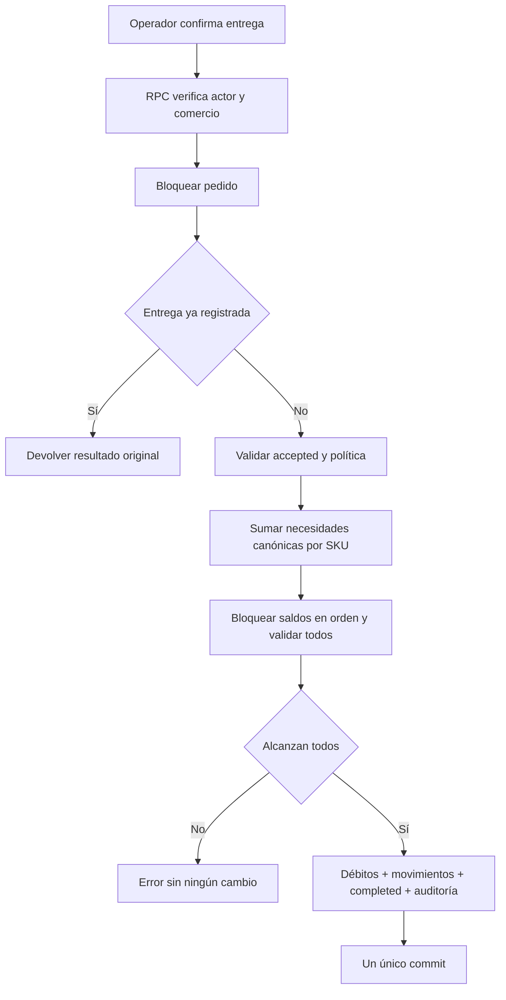

# Plan mayorista y stock al entregar

Fecha: **24/10/2026**. Diseño propuesto, **no implementado**. Base: commit `bf183767b8ba6012e2d33d177e473d5534669b9c`, rama `main`. Hallazgos y límites de evidencia en [AUDITORIA_MAYORISTA.md](AUDITORIA_MAYORISTA.md). Ninguna migración existente se modificó ni se ejecutó migración sobre base remota.

Regla confirmada: **las existencias físicas se descuentan sólo al confirmar entrega**. `generated`, abrir WhatsApp y `accepted` no descuentan. Se propone mantener el enum `completed` por compatibilidad y definirlo operativamente como entregado/retiro efectivamente realizado. No significa pago cobrado.

El objetivo cabe en React/PostgreSQL/Supabase/Vercel actuales. La suficiencia de suscripciones y la posibilidad de uso comercial aún requieren G02; no se autorizan upgrades ni otros servicios. No se agregan ERP, contabilidad, logística, microservicios ni integraciones inventadas.

## Diseño mínimo propuesto de stock (no implementado)

### Modelo y límites deliberados

La arquitectura actual es suficiente para resolver consistencia dentro de PostgreSQL/Supabase; no requiere colas, Redis, VPS ni otro servicio. No implica que capacidad/plan contratado estén verificados.

- `restaurants.inventory_mode`: `disabled` por defecto y `enforced` después de carga inicial validada; `inventory_started_at` y versión de política. Es decisión del servidor, nunca flag de cliente. Mantener modo pausado de entregas si hay contingencia, sin descartar ledger.
- `products.track_inventory` o configuración vinculada: decidir qué productos administran existencias. Para el mayorista, todos sus SKU físicos se activan explícitamente. `available` sigue siendo bloqueo comercial manual y se combina con stock cuando se proyecta disponibilidad; no reemplaza cantidad.
- `inventory_balances(restaurant_id, product_id, on_hand_base_units bigint NOT NULL CHECK >=0, initialized_at, updated_at)`, PK `(restaurant_id,product_id)`, FK compuesta a products. **Fila ausente significa no inicializado**, no stock cero inventado. Una fila con cero sólo nace de conteo inicial explícito. Nunca editar saldo desde frontend.
- `inventory_operations(id, restaurant_id, kind, order_id nullable, idempotency_key, request_hash, reason, actor_user_id, created_at, reverses_operation_id nullable)`. UNIQUE `(restaurant_id,idempotency_key)`; índice único parcial para una entrega por `(restaurant_id,order_id)`; FKs compuestas tenant. `kind`: opening, receipt, delivery, adjustment, physical_return, delivery_correction, external_sale. Motivo obligatorio para ajuste/corrección y canal/ref para venta fuera de app. Política sencilla sin tablas de proveedores/logística.
- `inventory_movements(id, operation_id, restaurant_id, product_id, delta_base_units bigint CHECK <>0, balance_after bigint CHECK >=0, order_item/source reference opcional, created_at)`. FK compuestas a operación y saldo; UNIQUE `(operation_id,product_id)` si cada operación agrega por producto. Saldos son lectura rápida; movimientos inmutables permiten reconciliar `saldo = suma movimientos`. Carga inicial cero puede tener operación/registro de conteo sin movimiento delta=0; no forzar movimientos falsos.
- `orders.inventory_policy_snapshot`/versión e `order_items.inventory_tracked_snapshot`, `stock_product_id_snapshot`, `sales_unit_snapshot`, `base_units_per_sale_snapshot`, `stock_quantity_base_snapshot`. Se calculan en servidor al crear, nunca desde precio, código libre ni datos reenviados por el cliente. Una línea futura con producto no rastreable o conversión faltante impide entrega y solicita corrección explícita. Reconciliar las líneas repetidas por stock_product_id, independientemente de notas/opciones que afectan precio.
- Índices: movimientos `(restaurant_id,product_id,created_at DESC,id)` y `(restaurant_id,order_id)` vía operación; operaciones por idempotencia/entrega. Sin índices indiscriminados ni almacenamiento duplicado de PII.

**Unidades pendientes:** actualmente cantidades son enteros; `code` identifica producto, opciones no inventario. MVP recomendable: un producto = un SKU físico, venta y stock en la misma unidad entera. No asumir que una promo 6× implica caja. Si el mayorista necesita unidad+caja del mismo saldo, hace falta una presentación con conversión fija a unidad base y snapshot (ejemplo hipotético que requeriría confirmación: caja de 12 → 12 unidades). Si necesita fracciones, elegir unidad mínima entera exacta (gramos/ml) o numeric con escala acordada y adaptar todas las validaciones, precios, DP, UI e importación; nunca float. No prometer fracciones ni variantes con stock en el MVP sin especificarlas. Dos presentaciones que comparten stock deben mapearse explícitamente al mismo SKU y agruparse antes de descontar.

### Operación única de entrega y concurrencia

Se puede mantener `complete_order(uuid)` como interfaz compatible, pero debe delegar a la única lógica `deliver_order`/helper privado. **No dejar un RPC antiguo ni un UPDATE directo que permita saltar stock.** API pública recibe order_id y opcional UUID de operación; cantidades/precios/actor/tenant se derivan en servidor. La idempotencia semántica por pedido protege aun con claves distintas.

Pseudoflujo dentro de **una sola transacción DB**:

1. Exigir auth.uid, perfil activo y rol permitido. Consultar tenant del pedido y comprobar pertenencia antes de devolver estado o resultado de replay. `SECURITY DEFINER SET search_path=''`, nombres calificados y EXECUTE sólo authenticated; helper privado no invocable anónimamente.
2. `SELECT orders ... FOR UPDATE` por ID, tenant autorizado. Esta fila serializa entregar, cancelar y cualquier futura edición/corrección. Todos esos flujos adquieren el mismo lock.
3. Si ya existe operación de entrega: devolver resultado persistido y flag `alreadyDelivered`, incluyendo si fue luego corregida/devuelta; **nunca volver a descontar**. Si status completed histórico sin ledger y política desactivada: devolver legado completado sin crear movimiento retroactivo. Si política tracked y completed sin ledger: error de integridad, no inventar éxito ni descontar a ciegas.
4. Exigir estado anterior `accepted`. Si el snapshot del pedido es `disabled`, completar con lógica histórica, evento y auditoría dentro de la transacción, sin tocar saldos. Esta rama corresponde a comercios sin inventario o pedidos legacy explícitamente resueltos al corte, nunca a una excepción inferida por el flag actual. Si el snapshot exige inventario, validar completitud de mapeos y seguir con el débito aunque el modo actual del comercio esté desactivado; una pausa operativa debe impedir entregar, no saltar el débito. Leer líneas persistidas y multiplicar conversiones snapshot con comprobación de rango; sumar por producto/SKU físico. No confiar en carrito ni ids/cantidades enviados de nuevo.
5. Bloquear **todas las filas de saldo** requeridas con `FOR UPDATE` en orden determinista de `(restaurant_id,product_id)`. Confirmar que no falta ninguna y que cada on_hand alcanza la suma. No usar lectura previa en JS ni secuencia de peticiones por producto. No usar SKIP LOCKED para descontar pedidos: se espera o se devuelve error reintentable, no se saltean ítems.
6. Insertar operación de entrega protegida por UNIQUE; ejecutar `UPDATE ... SET on_hand=on_hand-required ... AND on_hand>=required` y comprobar filas, insertar movimientos con delta negativo y saldo resultante. Validación de todos antes de mutar facilita errores legibles; CHECK>=0 es defensa adicional.
7. Cambiar accepted→completed, completed_by/auth.uid y completed_at, registrar order_events y audit_logs vinculados a operation_id. Retornar resumen estable. Toda excepción aborta saldo, movimientos, evento y estado juntos. No capturar excepciones para continuar con un subconjunto.

**Dos operadores, mismo pedido:** el segundo espera lock del pedido y obtiene replay tras el primer commit; una sola entrega/evento. **Timeout post-commit:** repetir devuelve la misma operación aunque la respuesta anterior se perdiera. **Dos pedidos, mismas últimas unidades:** locks de saldo comunes serializan; el segundo vuelve a ver saldo actualizado y falla completo por insuficiencia. **Varios SKU:** orden determinista reduce deadlocks; si ocurre deadlock/transitorio, retry acotado de la transacción completa con misma idempotency key; nunca de sentencias individuales. Todas las reposiciones/ajustes/devoluciones usan el mismo orden de locks para evitar actualizaciones perdidas.

El servidor devuelve códigos de negocio: NOT_ACCEPTED, INVENTORY_NOT_INITIALIZED, INSUFFICIENT_STOCK (lista mínima autorizada), ALREADY_DELIVERED, IDEMPOTENCY_CONFLICT. UI bloquea botón mientras está pendiente y refresca respuesta, pero eso es comodidad: la garantía reside en la transacción y constraints.

### Estados, cancelaciones, correcciones y devoluciones

| Transición/acción | Efecto en existencia | Regla |
|---|---|---|
| Crear/generated | Ninguno | No reservar ni prometer disponibilidad futura |
| Intento WhatsApp/whatsapp_opened | Ninguno | No demuestra envío ni aceptación |
| Tomar/accepted | Ninguno en MVP sin reservas | Operador revisa faltantes, aceptación no garantiza unidades futuras |
| accepted→completed (entregado) | Débito atómico una vez | Entrega física confirmada; actor y movimientos |
| generated/whatsapp_opened/accepted→cancelled | Ninguno | Nunca reponer lo no descontado; si luego se implementan reservas, sólo liberarlas |
| generated/whatsapp_opened→expired | Ninguno | No restaurar existencia |
| Editar pendiente | Ninguno en saldo sin reservas | Hoy no existe edición; mínimo cancelar/recrear. Si se implementa, RPC lock de pedido, recalcular precios/conversiones, versión y evento; no alterar snapshots silenciosamente |
| Modificar/reabrir entregado | Prohibido por flujo ordinario | No borrar entrega ni habilitar segundo débito |
| Entrega registrada por error | Compensación trazable autorizada | Sólo si no hubo salida física, motivo y referencia a entrega; conserva original y evento de corrección |
| Devolución física | Entrada explícita después de recepción | No automática por cancelación administrativa; actor, motivo y operación original |

MVP de correcciones/devoluciones: operación compensatoria completa, única por entrega, con referencia `reverses_operation_id` única; no se puede aplicar devolución completa y corrección completa sobre la misma salida. Conservar `completed` histórico y marcar la corrección/devolución mediante estado operativo adicional o campo/evento visible; no volver a `accepted` bajo el mismo ID. Si debe entregarse de nuevo, crear pedido nuevo vinculado, sin permitir redébito del original. Confirmar con negocio esta solución simple. Si parciales son necesarias, diseñar cantidades retornadas por movimiento original y límite acumulado <= entregado, bloquear el original para serializar devoluciones; no incluirlas como obligación sin confirmación. Una corrección total luego de retorno parcial debe calcular saldo pendiente o ser rechazada, nunca reponer todo otra vez.

### Existencia, disponibilidad y reservas

| Política | Ventaja | Consecuencia/Complejidad |
|---|---|---|
| Validar y descontar al entregar | Menor cambio, coincide con regla confirmada; saldos siempre físicos | Varios pendientes pueden competir por últimas unidades. El primero que entrega gana; aceptación no garantiza disponibilidad; requiere faltantes/cancelación/sustitución acordada |
| Reservar al tomar, consumir al entregar | Permite prometer disponible al aceptar sin adelantar descuento físico | `available = on_hand - reserved`, ledger/estados de reserva, liberación al cancelar/editar, expiración de reservas/retenciones y locks adicionales; las ventas externas deben respetarla |

**Recomendación:** MVP sin reservas sólo si el mayorista acepta explícitamente el riesgo de pendientes concurrentes; mostrar “sujeto a disponibilidad hasta entrega” y faltantes al operador. Si aceptar un pedido debe garantizar mercadería, la reserva al tomar pasa a requisito comercial y se diseña antes de vender esa promesa. Validar al crear no reserva ni garantiza disponibilidad posterior. Consultar stock antes de aceptar es informativo; puede cambiar inmediatamente después.

### Permisos y acceso

- Lectura saldos/movimientos: `restaurant_admin` y `order_manager` activos del mismo comercio; considerar ocultar ajustes internos al gestor si negocio lo pide, sin inventar nuevos roles por defecto.
- Entregar: roles que actualmente `private.can_manage_orders` autoriza, manteniendo superadmin con AAL2. Pertenencia y perfil se revisan en servidor incluso en replay.
- Carga inicial, ingresos, ajustes, ventas fuera de app, correcciones y devolución: `restaurant_admin` del comercio; superadmin AAL2 sólo soporte explícito auditado. `order_manager` no ajusta inventario arbitrariamente.
- RLS de lectura tenant; sin INSERT/UPDATE/DELETE de saldo/ledger para anon/authenticated, sólo RPCs estrechos. Revocar PUBLIC por defecto y verificar grants explícitos en migraciones nuevas. Movimientos/operaciones append-only, UPDATE/DELETE protegidos. Un GUC interno no reemplaza permisos/RLS.
- Menú público sólo devuelve disponibilidad necesaria (o cantidad pública si negocio lo autoriza); nunca actor/motivos/costos/ledger. Para productos sin control conservar `available`. Para controlados usar `available AND stock>0`, sin prometer disponibilidad futura.

### Ventas por otros canales

No existe integración demostrada con caja, local, teléfono u otro sistema. El saldo será confiable sólo si se registran todas las salidas físicas. Agregar en la misma UI una salida externa con producto, cantidad, canal/ref/motivo y actor, con idempotencia y locks. Registrar al entregar también en ese canal para mantener semántica. Definir quién y cuándo la carga; no inventar sincronización ni presentar el saldo como exacto si se actualiza sólo al cierre. Importación de productos **no escribe stock**; una carga de conteo/reposición separada muestra preview, motivo, idempotency key y totales antes de confirmar.

### Incorporación compatible, corte y reversión

1. Migración aditiva futura, inventario disabled para todos, sin llenar existencias ni tocar históricos. UI/lecturas compatibles con disabled. Tests locales y staging antes de remota; no ejecutar en esta auditoría.
2. Acordar unidades por SKU, origen de conteo y responsable/canales. Preview de carga inicial por UUID/código resuelto dentro del comercio, validación duplicados/unidades y confirmación transaccional. Cada saldo inicial trazado.
3. Resolver pedidos abiertos al corte: opción simple es ventana breve sin pendientes; alternativa lista explícita de pendientes a incorporar con mapeos/cantidades y política snapshot. No dejar pedidos anteriores activos entregándose sin una política visible; ningún completed/cancelled/expired histórico genera descuentos.
4. Activar en transacción tras comprobar saldos y cobertura de SKU, registrando fecha/política. Toda alta nueva de producto rastreado queda no inicializada hasta conteo; importación no cambia ese estado accidentalmente.
5. Piloto de un comercio; revisar saldo físico y ledger cada jornada inicial. Alertar sobre inconsistencias por consultas existentes/logs, no nuevo servicio.
6. Reversión: desactivar nuevas capturas de stock o pausar entregas, conservar saldos/ledger/políticas de pedidos ya creados. `complete_order` jamás puede caer al camino antiguo para pedidos tracked aunque se retire UI o se cambie el flag del comercio. No restaurar DB antigua ni borrar movimientos como rollback de funcionalidad; cualquier corrección es compensación trazable. Reanudar sólo tras conciliación.

### Archivos y flujos concretos a modificar en la etapa futura

| Cambio | Lugares |
|---|---|
| Modelo/RLS/constraints/funciones inventario y hardened complete_order | Nuevas migraciones aditivas `supabase/migrations`, tests `supabase/tests`; regenerar `src/types/database.generated.ts` |
| Snapshot política/conversión al crear; hash idempotencia | Última `create_order_transaction` mediante nueva migración; `create-order/index.ts`, `_shared/schemas.ts`, `_shared/errors.ts` |
| Recuperación de checkout y cambio de total | `CheckoutPage.tsx`, `OrderGeneratedPage.tsx`, `checkout-attempt.ts`, schemas/domain; endpoint estrecho de recuperación si se incorpora |
| Cantidades/limites/líneas inválidas | `CartProvider.tsx`, `CartPage.tsx`, `ProductDialog.tsx`, `quantity-pricing.ts`, Edge schema y SQL |
| Entregar/mostrar faltantes/movimientos y actor | `OrderDetailPage.tsx`, `ClaimOrderPage.tsx`, `orderSchemas.ts`, `OrderStatus.tsx`, `src/lib/orders.ts`; nuevo panel inventario |
| Activación/carga inicial/reposiciones/ajustes | `RestaurantSettingsPage.tsx`, `ProductEditorPage.tsx`, `ProductsPage.tsx`, rutas `App.tsx`/`AdminLayout.tsx`; importación de stock separada de catálogo |
| Disponibilidad pública | `get_public_menu` wrapper vigente y helper, `PublicProduct`, API/Zod/usePublicMenu; caché invalidada al cambiar stock sin publicar ledger |
| Fechas de entrega, CSV y reporting | `get_order_metrics` nueva versión, `AdminDashboardPage.tsx`, `OrdersPage.tsx` |

### Criterios de aceptación futuros (no ejecutados)

| ID | Caso | Resultado obligatorio |
|---|---|---|
| AC01 | Entrega normal de 2 SKU con saldo | Estado+actor+evento+todos los movimientos/saldos se confirman juntos; snapshot monetario intacto |
| AC02 | Doble clic y reintento con igual o distinta key, mismo pedido | Una operación de entrega, un débito por SKU, una transición; retorno ya entregado |
| AC03 | Timeout después del commit / desconexión | Retry devuelve la misma operación/estado/saldo, sin nuevos movimientos |
| AC04 | Dos sesiones reales entregan mismo pedido simultáneamente | Un ganador; otro replay; actor original intacto |
| AC05 | Dos pedidos de 4 unidades compiten por 5 | Uno completed y saldo 1; otro accepted/insuficiencia sin movimientos; nunca -3 |
| AC06 | Uno de varios SKU insuficiente o sin saldo inicial | No se modifica ningún saldo/estado/evento; identifica faltante autorizado |
| AC07 | Excepción inyectada entre débito y evento/cambio estado | Rollback total; retry posterior una sola entrega |
| AC08 | Cancelación antes de entregar y carrera cancelar/entregar | Cancelar no repone; una transición gana según lock; no estado cancelado con débito oculto |
| AC09 | Corrección de entrega falsa repetida/concurrente | Compensación una vez con motivo/actor/referencia, original visible; no segunda entrega con mismo ID |
| AC10 | Devolución real y solicitud de corrección posterior | No doble reposición; suma retornada nunca excede lo entregado; cancelación administrativa no suma stock |
| AC11 | Anon, miembro de otro comercio, perfil suspendido, gestor intentando ajuste | Denegado antes de cualquier lectura sensible o mutación, incluso replay y RPC antiguo |
| AC12 | Producto repetido con distintas notas/opciones | Suma total por SKU físico para saldo; descuentos monetarios conservan su regla definida |
| AC13 | Caja/unidad compartiendo SKU, conversión modificada luego (si requerida) | Consume conversión snapshot exacta, agrupada; cambia catálogo sin reescribir pendiente/histórico |
| AC14 | Activación con pendientes/históricos, desactivación de feature, rollback UI | Ningún histórico recibe stock retroactivo, pendientes con política explícita; tracked no puede saltar débito por RPC legado |
| AC15 | Ingreso/ajuste/salida externa/importación repetida y concurrente | Clave+hash idempotentes, locks comunes, actor/motivo, saldo no negativo y conciliación ledger exacta |

Agregar para fracciones/entregas/devoluciones parciales sólo si se confirman: precisión exacta, límites, cantidad remanente y retornos acumulados. Las pruebas SQL existentes hacen replay/claim secuenciales (`002_orders_claim_storage.sql:86–159`) y promociones/histórico (`010_product_quantity_pricing.sql:345–442`); no reemplazan pruebas de dos conexiones simultáneas sobre el stock futuro. Procedimiento aislado: seed sintético tenant A/B y roles, barrera de inicio en dos sesiones SQL, inyectar fallos antes del commit, contar operaciones/eventos y verificar suma movimientos=saldo. Sin entorno DB disponible, dejar estos escenarios pendientes, nunca declarar concurrencia probada por inspección.

## Precisiones de integridad para implementar

- **Política estable:** al crear pedido, leer/bloquear la política del comercio de forma compatible con su activación y guardar versión. La activación debe serializarse con creaciones en curso. No leer el flag en JS y escribir el pedido después. Para el mayorista, los nuevos SKU físicos deben heredar control obligatorio/no inicializado; importación general no puede crear una excepción `track_inventory=false`. Excepciones sólo por administrador, explícitas/auditadas y válidas para pedidos futuros.
- **Datos históricos:** un código se puede reutilizar tras baja; ledger/referencias usan UUID estable y tenant. No se hace merge de saldos por nombre/código mutable. Una opción que representa físicamente otro SKU exige un mapeo explícito; hasta resolverlo el producto controlado no se publica/vende como si compartiera stock.
- **Invariantes DB:** PK/FKs compuestas, on_hand>=0, delta no nulo, unicidad entrega/operación, ledger append-only y ausencia de grants de escritura directa. Toda ruta vigente de completed delega en la misma función; revisar triggers de guardia de orders y comprobar que ningún RPC alternativo complete sin movimiento cuando policy lo exige. Considerar constraint trigger diferido que verifique la relación completed↔operación de entrega para pedidos tracked, sin depender de un flag UI. El service_role sigue siendo una credencial altamente privilegiada, no una frontera frente a un administrador DB malicioso.
- **Orden de locks:** las rutas de entrega/cancelación/edición bloquean pedido primero; luego saldos ordenados por UUID. Las operaciones que corrigen/retornan bloquean también la operación original y adoptan el mismo orden documentado, sin tomar saldo antes de pedido. Revalidar actor/rol dentro de RPC; una invitación no puede saltarse S01.
- **Idempotencia por contenido y negocio:** mismo UUID+hash devuelve respuesta guardada; UUID reutilizado con otro payload produce conflicto. Una nueva key para el mismo pedido tampoco permite otra entrega: protege el índice único por pedido. El resultado de replay indica saldo **al momento de la operación**; si se muestra saldo actual se lee/rotula separadamente. Nunca prometer exactamente una petición HTTP: se garantiza un único efecto confirmado.
- **Importes/unidades:** usar bigint o numeric de escala fijada, validar overflow de suma/multiplicación y representación segura en TypeScript. Snapshots físicos no se recalculan con conversiones cambiadas en catálogo. Los precios/promos siguen las reglas de agrupación actuales hasta que se acuerde otro contrato; stock siempre agrega por SKU físico.
- **Carga inicial/ajustes:** carga inicial no es upsert de existencia desde Excel general. Operación separada con idempotencia, preview y actor. Un conteo de cero inicializa explícitamente; ausencia sigue bloqueando. Si se ingresa un saldo contado absoluto, exigir versión esperada y calcular delta contra saldo bloqueado; ante actividad concurrente rechazar y reconciliar, para no borrar una entrega recién registrada. Reposición normalmente es delta positivo, no sustitución de saldo.
- **Pendientes al corte:** cerrar pendientes antes del inicio es la opción más simple. Si no es viable, revisar uno por uno en lote explícito, mapear UUID/unidades y establecer snapshot sin descontar todavía. El conteo físico inicial incluye mercadería aún no entregada. No se dejan pendientes entregables por un camino legacy silencioso. Pedidos históricos terminales nunca se debitan retroactivamente.

Las cajas K y L pertenecen a la misma transacción que C–H. Cualquier error de K revierte también los débitos; no existe commit intermedio por producto. Si se pierde la respuesta de L, repetir vuelve a E.

## Plan priorizado

Esfuerzo relativo S/M/L, con jornadas orientativas del informe; no sumar mecánicamente tareas solapadas ni interpretar esto como presupuesto/fecha comercial. Cada etapa termina con evidencia verificable. Las fases 1 y 2 y los controles de piloto aplicables son condición para ofrecer **inventario**. Las tareas condicionales pasan a obligatorias cuando el negocio confirma su necesidad.

### 1. Bloqueantes antes de vender

| ID / hallazgo | Alcance y beneficio | Dependencias | Esfuerzo | Validación de cierre | Costos/mantenimiento |
|---|---|---|---|---|---|
| B01 / S01 | Endurecer upsert de membresía: rol previo/último admin, actor y objetivo bloqueados, invitación repetida no-op; elimina degradación indebida | Ninguna | M | pgTAP+handler aislado: A no degrada B ni último admin; carreras; alta/reinvite manager válido | Sin servicio; menos rescates manuales |
| B02 / S03,S04,G01 | Corte streaming de cuerpos, precheck cardinalidad antes Zod, versiones/locks compatibles y formato CI | Ninguna; evaluar compatibilidad versión mayor | M | Payloads excesivos cortan anticipadamente; máximos válidos; suite Edge/frontend/audit limpia y npm ci reproducible | Menos CPU/memoria antes de antiabuso; parches residuales |
| B03 / C02,C10,C11,C05 | Importación patch/solo precios, decimales estrictos, grafo de opciones válido y max>=1; preview de campos modificados | Contrato columnas/precios; inspección read-only de datos antes futura constraint | M–L | Precio no reactiva agotado; max0/min inválido rechazado; lote atómico; CSV/XLSX y errores correctos | Menos correcciones/pedidos imposibles; no inventario en importador general |
| B04 / C01 | Paginar/buscar/filtrar admin en servidor y orden estable con id, indicador de totalidad | Ninguna | M |999/1000/1001/1500/5000 productos; último SKU accesible y ningún duplicado | Menor payload/fotos; algo más de requests por navegación |
| B05 / O02,O07,C09 | Acordar pedido máximo y unidad; unificar límites en UI/Edge/SQL y cantidad numérica; validar WhatsApp largo | Ejemplos de compra/unidades; sólo ampliar topes necesarios | M, L si fracciones/conversiones | Límite±1, suma global, overflow, paquetes/promos, preview mensaje; aceptación operador | Payload/CPU mayor si se amplía; mantener cotas antiabuso |
| B06 / O03,O08,C03,O04 | Intento recuperable con hash completo/conflicto, resolver timeout antes de crear nueva key; marcar líneas inválidas y explicar precio actualizado | Token de recuperación mínimo; contrato de aceptación de precio | M–L | Commit+timeout+retry; domicilio cambiado; recarga/2 h; precio/agotado desde otra sesión; una orden o conflicto visible | Lectura extra sólo recuperación; menos duplicados/intervención |
| B07 / G02 | Verificar planes y permiso comercial, recursos/uso, backup+Storage/restore, SMTP/Turnstile y deployment de referencia | Acceso a configuración/contrato actual, sin nuevos pagos autorizados | S–M | Evidencias plan/uso y restore en destino aislado; RPO/RTO observado; Auth/CSP reales | Determina si alcance cabe en suscripción; no upgrade implícito |
| B08 / G01 y cobertura | Alinear PG local17.6 y Node 22, instalación desde lock, reconstrucción 23 migraciones y suites actuales antes de ampliar | Entorno local aislado; Docker/Podman ausente en host actual | M |276 aserciones pgTAP actuales más nuevas,31 helpers y frontend/E2 E; runs CI verificables | Usa herramientas locales/proveedor actual; evita drift |

### 2. Implementación mínima de stock

| ID | Alcance y beneficio | Dependencias | Esfuerzo | Validación | Costos/mantenimiento |
|---|---|---|---|---|---|
| I01 | Migración **nueva aditiva**: política, saldos, operaciones/movimientos, snapshots, constraints/RLS/grants/índices; tipos regenerados | B01,B05,B08; unidad/SKU definidos | M | Modelo se reconstruye; A/B aislados; no grants directos; balances no inicializados distintos de0 | Másfilas/disco; sin servicios nuevos |
| I02 | RPC única entregar + wrapper complete_order compatible, locks ordenados, agregación de líneas, disponibilidad, ledger/estado/evento/audit atómicos | I01 | L | AC01–AC08,AC11–AC14 con dos conexiones reales y fallo inyectado | Un débito/movimiento por SKU; locks breves; sin cola externa |
| I03 | Carga inicial/reposición/ajuste/salida externa por RPC idempotente, preview/motivo/responsable/versión | I01; conteo y responsable otros canales | M | AC15, conteo0, falta saldo, import repetido, ajuste concurrente entrega y overflow | Conciliación física/carga externa residual imprescindible |
| I04 | Corrección/devolución **completa** trazable, una compensación por entrega; originales inmutables y sin reapertura ordinaria | I02; política de devolución confirmada | M | AC09/AC10: corrección/retorno concurrentes sin doble reposición | Ledger adicional; revisión humana de mercadería recibida |
| I05 | UI inventario/pedidos: Confirmar entrega, faltantes, saldo/ledger, ingresos/ajustes, activación admin; query invalidation | I02–I04 | M–L | Operador completa flujo, error insuficiente corregible, timeout/replay visible; mobile admin | Reduce errores; sin rediseño visual general |
| I06 | Disponibilidad pública derivada y refresco acotado, manteniendo bloqueo manual y sin exponer ledger/costos | I01/I02,B06 | S–M | Saldo0/positivo/no inicializado; cliente abierto ve actualización; stock no es reserva | Lecturas acotadas; no Realtime por SKU |
| I07 | Corte/piloto un comercio: conciliación, pendientes, conteo, activar transaccional, rollback de UI sin bypass de stock | I01–I06,B07/B08 | M | AC14; revisión diario inicial; ninguna venta histórica debitada; entregas legacy probadas | Trabajo inicial de conteo; después controles operativos definidos |

Un MVP con unidad entera y un SKU por producto evita administrar conversiones innecesarias. Si caja/unidad comparten existencia, I01/I02 incluyen mapeo explícito y snapshots; si hay fracciones, reestimar B05/I01/I02 antes de comprometer fecha. No se supone que las opciones actuales son variantes físicas.

### 3. Mejoras importantes para operar con confiabilidad

| ID / hallazgo | Alcance y beneficio | Dependencias | Esfuerzo | Validación | Costos/mantenimiento |
|---|---|---|---|---|---|
| R01 / C04 | Lazy admin, render público por categoría/carga incremental conservando búsqueda completa; cache de cálculos según perfilado | B04; benchmark baseline | M | Repetir27 corridas y celular real; bajar DOM/long tasks sin ocultar último SKU | Menos CPU/fotos; no virtualización automática |
| R02 / C06,C07,C08 | Compare-and-set catálogo, compensación de imagen incierta, reintentar sólo pendientes, JSON preflight, filas originales | B03 | M–L | Dos editores; timeout postupdate;1 fallo/500 sin repetir499;2 MiB±1;errores en fila correcta | Menos uploads/huérfanos y trabajo manual |
| R03 / O05,O06,G03 | Cursor/export con alcance claro, métricas por fecha entrega, directorios completos; proyección/debounce/índices medidos | B04/I02 para métricas stock | M |2000+pedidos durante cambios, max_rows500; medianoche; totals SQL correctos | Menos transferencia/CPU; snapshot exacto de export sólo si requerido |
| R04 / S02,S05,S06 | Throttle register, confianza de IP verificada, rate limits por tenant con techo y NAT/replays; Turnstile coherente | B02; pico comercial y gateway | M | Inválidos acotados; evento válido/replay; NAT; cabecera no falsificable en staging | Menos abuso/costo; no desactivar protección por ampliar pedidos |
| R05 / O09,S07 | Unificar vencimiento, agendar expire/cleanup en capacidades existentes y vigilar job; retención explícita de auxiliares | B07; pg_cron ausente; scheduler externo sin verificar | S–M | Creado10 h vence12 h coherente; replay de negocio preservado; job/alerta observable | Menos datos auxiliares/incidentes; no borrar ledger por antigüedad |
| R06 / S08,S09 | Onboarding recuperable sin invitaciones incongruentes, limitar fallback Auth masivo a reparación explícita | B01 | M | Auth/email simulado+fallo DB; retry mismo tenant/usuario; sin duplicación | Menos llamadas Auth/soporte; sin emails reales de prueba |
| R07 / G04 | Formatear/extraer reglas al tocar módulos y añadir tests de contratos de negocio | Cambios de etapas1/2 | S incremental | Mismo comportamiento, cobertura de diferencias SQL/TS y errores, no tests espejo de markup | Reduce costo futuro; no reescritura |
| R08 / capacidad | Ejecutar matriz A/B/C aislada de informe, EXPLAIN/RLS/Realtime y piloto con volúmenes acordados | Entorno B08, funcionalidades listas | M | Latencias/errores/bytes/consumo por escenario y tenant registrados;0 integridad; cupos validados | Puede acotar alcance al plan real; no carga en producción |

R01/R08 y cualquier P2 con impacto presente en el piloto se cierran **antes de habilitar volumen comercial** aunque se agrupen aquí como confiabilidad. La prioridad no autoriza omitir una prueba necesaria.

### 4. Mejoras opcionales que pueden esperar

| ID | Alcance/beneficio | Dependencias | Esfuerzo | Validación | Costos/mantenimiento |
|---|---|---|---|---|---|
| X01 | Reservar al aceptar sólo si se debe garantizar disponibilidad; no descuenta existencia física | Regla comercial explícita; I01/I02 | M–L | Reserva/consumo/liberación idempotentes, competencia última unidad, ventas externas respetan reserva | Másestados/retención/conciliación; no default |
| X02 | Entrega/devolución parcial si flujo real lo exige | Confirmación negocio; ledger estable | L a reestimar | Remanentes/retornos acumulados exactos; nunca reponer más de entregado | Máscomplejidad/UI; no inventar necesidad |
| X03 | Tramos/precio por presentación si promos actuales no sirven; carga masiva de reglas de cantidad | B05/O07 | M |11/12/13, notas/configuraciones, snapshots históricos | Gestión comercial adicional; no listas por cliente/ERP sin pedido |
| X04 / G05 | RPC de marca para OG | Medición de costo crawler | S | OG equivalente/mínimos bytes/control publicación | Menor trabajo DB; misma Function |
| X05 | Virtualización/índice trigram/batch SQL de menú | Profiling demuestra cuello tras R01 | S–M según hallazgo | Mejora antes/después en fixture; sin pérdida búsqueda/RLS | No dependencia/índice sin beneficio medido |

## Puertas de validación y reversión

1. **Base segura:** B01–B04 y B08 verdes; contrato B05/B06 acordado; sin datos nuevos inconsistentes. Registrar scripts/results con SHA y entorno. Revisar datos que violan nueva constraint mediante SELECT antes de aplicar; planificar corrección explícita, no ocultarlos.
2. **Inventario correcto:** AC01–AC15 pasan, incluyendo conexiones simultáneas, actor de otro tenant y RPC antiguo. Además comparar ledger agregado con todos los saldos. Prueba negativa sin permisos debe fallar antes de devolver resultado de replay.
3. **Operación realista:** operadores completan carga inicial→pedido→entrega→devolución/corrección→venta externa sintética; precios/códigos/unidades claros. Excepciones de negocio registradas.
4. **Piloto y capacidad:** cerrar B07/R08; usar alcance medido y RPO/RTO aceptado. Si no está demostrado, declarar capacidad pendiente y no vender garantía de disponibilidad/concurrencia.
5. **Reversión:** pausar nuevas entregas controladas o nuevas activaciones, conservar funciones que protegen pedidos tracked y todo ledger. Rollback de frontend no habilita complete_order antiguo. No restaurar snapshot DB anterior para borrar efectos de ventas; compensar operaciones concretas autorizadas y reconciliar. No purgar idempotencia/operaciones al desactivar.

Despuésde implementar, el despliegue requiere migración incremental compatible→Edge compatible→frontend→smoke aislado y piloto. Vercel no despliega Supabase automáticamente. Respaldos/observación y un procedimiento de reparación deben existir antes de activar stock; no instalar un proveedor nuevo por defecto.

## Decisiones de negocio pendientes y propuesta inicial

| Decisión | Propuesta mínima | Qué cambia si difiere |
|---|---|---|
| Unidad y SKU | Un producto=SKU físico, unidad entera, salvo necesidad confirmada | Presentaciones/fracciones requieren conversión exacta/snapshots y revisar límites/precios/import |
| Pedidos máximos | Acordar con ejemplos;25 líneas/100 unidades actuales no se suponen suficientes | Política por tenant con techo probado y mensajes WhatsApp adecuados |
| Disponibilidad al aceptar | Sin reserva, explícitamente sujeta a disponibilidad hasta entrega | Si aceptar garantiza mercadería, X01 se vuelve bloqueante |
| Stock negativo | Prohibido; insuficiencia revierte toda entrega | No habilitar excepciones silenciosas; definir autorización/evento si negocio las pide |
| Otras ventas | Responsable registra salida al entregar en otros canales y concilia | Sin actualización de canales no se puede prometer saldo real en tiempo real |
| Ajustes/devoluciones | Admin; motivo y recepción física para devolución | Delegación sólo explícita; no derivarla de permiso para tomar pedido |
| Parciales | Fuera del MVP hasta confirmar | Rediseñar acumulados/remanentes y aceptación, sin imponer módulo logístico |
| Pendientes/corte | Ventana sin pendientes; si no, revisión/importación explícita de política | Nada de retrodescontar históricos ni inventar existencias |
| Plan/recuperación | Conservar contratos actuales y comprobar elegibilidad/capacidad/RPO | Si no cumplen y no se autoriza cambio, limitar compromiso o no ofrecer alcance |

Orden recomendado: corregir autorización y entradas/importaciones, fijar contrato comercial y reproducibilidad, implementar entrega atómica+inventario y recuperar intentos, validar operadores/capacidad/restauración. Las mejoras opcionales sólo se activan por necesidad demostrada. Este documento no autoriza ejecutar las migraciones propuestas ni cambia suscripciones.
